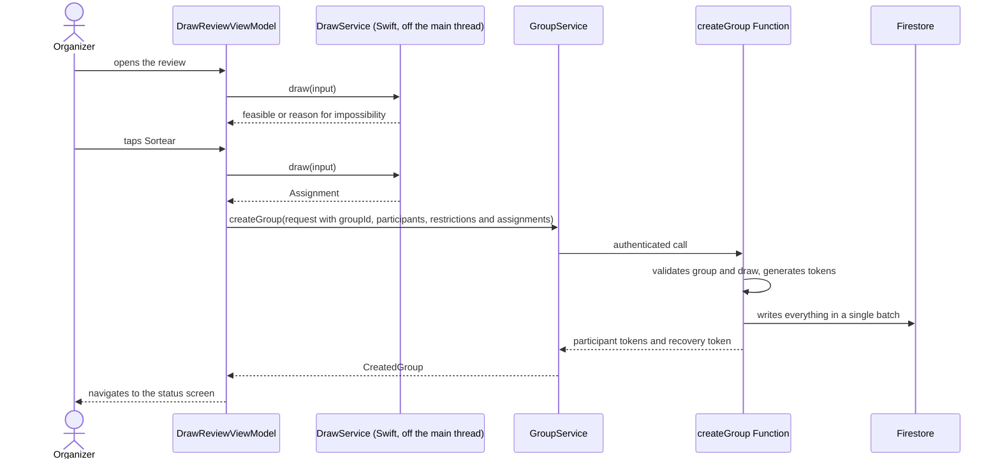
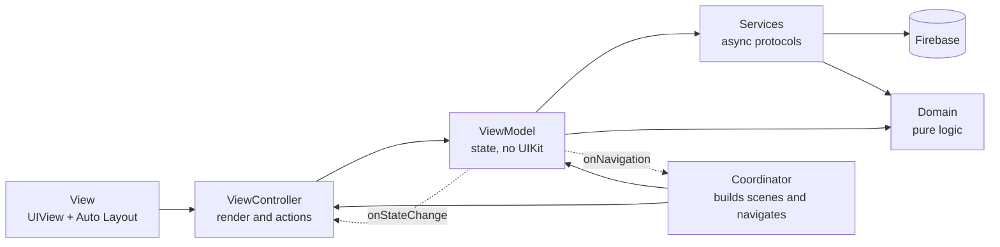
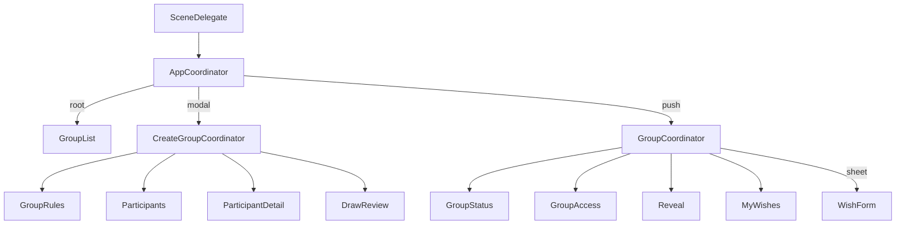

# Sortix — Secret Santa · v1 Specification

> Document version 1.0 · 2026-10-31 · Status: approved for development
>
> This document consolidates every decision made for v1. When the code and this document disagree, one of them is wrong: fix the code or update the document in the same commit.
>
> Language: this document, like everything else in the repository, is written in English. User-facing texts are quoted in pt-BR, exactly as they appear in the String Catalog and in the website locale files.

## Table of contents

1. [Overview and v1 scope](#1-overview-and-v1-scope)
2. [Glossary](#2-glossary)
3. [Business rules](#3-business-rules)
4. [Detailed flows](#4-detailed-flows)
5. [Screen specification](#5-screen-specification)
6. [MVVM-C architecture](#6-mvvm-c-architecture)
7. [Folder structure](#7-folder-structure)
8. [Localization strategy](#8-localization-strategy)
9. [Comment policy](#9-comment-policy)
10. [Draw algorithm](#10-draw-algorithm)
11. [Firestore data model](#11-firestore-data-model)
12. [Firestore security rules](#12-firestore-security-rules)
13. [Cloud Functions contracts](#13-cloud-functions-contracts)
14. [Universal Links](#14-universal-links)
15. [Edge cases](#15-edge-cases)
16. [Testing strategy](#16-testing-strategy)
17. [App Store review checklist](#17-app-store-review-checklist)
18. [Schedule until 11/23](#18-schedule-until-1123)
19. [v2 list](#19-v2-list)

---

## 1. Overview and v1 scope

### 1.1 Product

Sortix is an iPhone app that organizes Secret Santa ("amigo secreto") without sign-up. The organizer creates the group, sets the rules, adds the participants and the restrictions, and runs the draw on their own iPhone. Then they send each participant a personal link through WhatsApp. People who have the app open the link in the app; people who don't open it on the website. Each person reveals who they drew, sees that person's gift suggestions and adds their own suggestions.

### 1.2 Goals

- Ship to the App Store by 2026-12-10 and have real users at Christmas.

### 1.3 Product principles

| # | Principle | Practical consequence |
|---|---|---|
| P1 | No sign-up, ever | Invisible anonymous authentication. There is no login in v1 or v2. Recovery uses a link, not an account. |
| P2 | Participants don't need to install anything | The whole participant flow (access, reveal, suggestions) works on the website. |
| P3 | The organizer takes part without seeing who drew whom | The interface never shows another person's result. The result lives in a collection the app does not read. |
| P4 | Simple and fast | No field beyond what is needed. The only thing the organizer is asked about themselves is their own name. |
| P5 | Native and accessible | iOS grouped list look, dark mode, Dynamic Type and basic VoiceOver. |
| P6 | Ready for other languages | No user-facing text in code; dates, currency and numbers formatted by locale. |

### 1.4 Identity and configuration

| Item | Value |
|---|---|
| App Store name | Sortix - Amigo Secreto |
| Name under the icon | Sortix |
| Subtitle | Sorteio fácil com link pessoal |
| Domain | `sortixamigosecreto.com.br` |
| Bundle ID | `br.com.sortixamigosecreto.app.Sortix` (final after the first submission) |
| Firebase project ID | `sortix-amigo-secreto` (final) |
| Firestore and Functions region | `southamerica-east1` (São Paulo) |
| Minimum iOS | 17.0 |
| Devices | iPhone only, portrait only |
| Countries | Brazil only |
| Language | Brazilian Portuguese (pt-BR), ready for others |
| Tooling | Xcode 26 or later, Swift 6 (language mode 6, strict concurrency) |
| Dependencies (SPM) | Firebase iOS SDK (FirebaseAuth, FirebaseFirestore, FirebaseFunctions, FirebaseCrashlytics) |
| Backend | Firebase: anonymous Auth, Firestore, 2nd gen Cloud Functions in TypeScript, Hosting, Blaze plan with a budget alert |
| Apple account | Apple Developer Program as an individual (your legal name appears as the seller) |

The App Store name, the name under the icon and the subtitle are user-facing texts, so they stay in pt-BR.

### 1.5 In v1

- Group list (organized and joined), with an empty state and an "About" menu (privacy policy, support, version).
- Group creation in three steps: rules; participants and restrictions; review and draw.
- Draw on the organizer's iPhone, without mutual pairs, with one-way restrictions and a clear explanation when it is impossible.
- Atomic group write through a Cloud Function, which validates the draw and generates the tokens.
- Group status screen for the organizer: sending and resending links, per-participant status, recovery link, group deletion.
- Access through the personal link in the app (Universal Link) and on the website.
- Reveal with the drawn name and that person's suggestions.
- Gift suggestions: add, edit and remove, in the app and on the website, up to 5 per person.
- Organizer recovery link.
- Automatic data expiration (Firestore TTL).
- Static website (HTML + JavaScript, no framework) with access, reveal, suggestions, recovery page, privacy policy and support.
- pt-BR localization with a String Catalog and typed symbols; website with one JSON file per language.
- Dark mode, Dynamic Type and basic VoiceOver.
- Crashlytics (crash reports only, no analytics).
- Unit tests for the draw algorithm and the validations.

### 1.6 Not in v1

Everything in [section 19](#19-v2-list). In short: editing a group or redoing the draw, notifications, marking a gift as bought, link previews with an image, regenerating tokens, other languages, iPad, other countries and App Check.

### 1.7 Changes from the original brief

These decisions were made while writing the specification and replace what was in the brief.

| Topic | Brief | Final decision | Reason |
|---|---|---|---|
| Restrictions | To be defined | One-way: "X cannot be drawn by Y" | The goal is to stop someone from drawing the person who will buy their own gift (e.g. a child and their mother). |
| Draw shape | To be defined | No mutual pairs; cycles of 3 or more people; more than one cycle allowed | Product request. Allowing more than one cycle reduces impossible cases. |
| Where the draw runs | Cloud Function recommended | On the organizer's iPhone; the Function only validates and writes | Privacy enforced by the interface is enough. The whole core stays in Swift. |
| Maximum participants | To be defined | 50 | Product request. |
| Edit and remove suggestions | v2 | v1, in the app and on the website | Considered essential. |
| Login | Sign in with Apple in v2 | Never. Replaced by the recovery link | Principle P1. |
| "Group drawn" screen | End of `CreateGroupCoordinator` | Belongs to `GroupCoordinator` | The same screen opens from the group list. After the draw, the Back button must not lead back to the review. |
| Creation flow | Push on the main navigation | Presented modally with its own navigation | iOS standard for creation; allows confirming the discard when closing. |
| Suggestion form | On the "My suggestions" screen itself | Separate sheet (screen 8b), used to add and edit | With editing in v1, a single form for both cases avoids duplication. |
| Participant name | To be defined | Up to 20 characters | Product request. |

---

## 2. Glossary

| Term | UI term (pt-BR) | Name in code | Definition |
|---|---|---|---|
| Group | Grupo | `Group` | One Secret Santa: name, rules, participants and draw. |
| Group draft | Rascunho do grupo | `GroupDraft` | Data of a group being created, kept only in memory until the draw. |
| Group rules | Regras do grupo | `GroupRules` | Maximum value, date, location and notes (all optional). |
| Maximum value | Valor máximo | `maxGiftValue` (`Money`) | Amount in minor units (cents) plus the currency code. |
| Event date | Data da confraternização | `eventDate` (`CalendarDate`) | Date without time, stored as `YYYY-MM-DD` text. |
| Location | Local | `location` | Free text. |
| Notes | Observações | `notes` | Free text (on the group and on a suggestion). |
| Organizer | Organizador | `organizer` (`organizerUid`, `isOrganizer`) | Who created the group. Also a participant. Identified by the device's anonymous UID. |
| Participant | Participante | `Participant` | Person who draws and is drawn. |
| Giver | Quem tira | `giver` (`giverId`) | Participant who will give the gift. |
| Receiver | Quem é tirado | `receiver` (`receiverId`) | Participant who will receive the gift. |
| Restriction | Restrição | `Restriction` (`forbiddenGiverIds`) | "X cannot be drawn by Y". Stored on the drawn participant (`receiver`) as the list of who cannot draw them. |
| Draw | Sorteio | `Draw` (`DrawEngine`, `DrawService`) | Computing who draws whom. |
| Assignment | Atribuição | `Assignment` | Draw result: one `receiverId` for each `giverId`. |
| Cycle | Ciclo | `cycle` | Sequence A→B→C→A within the draw. |
| Mutual pair | Par mútuo | `mutualPair` | A draws B and B draws A. Forbidden. |
| Access token / personal link | Link pessoal | `AccessToken` (`token`) | 43-character secret that identifies a participant. Forms the `/g/<token>` link. |
| Recovery link | Link de recuperação | `RecoveryToken` (`recoveryToken`) | Organizer secret that moves group administration to another device. Forms the `/r/<token>` link. |
| Link shared | Link enviado | `linkShared` (`linkSharedAt`) | Moment the organizer completed sharing the link. |
| Reveal | Revelação | `reveal` (`revealedAt`) | Moment the participant tapped "Revelar" for the first time. |
| Gift suggestion | Sugestão de presente | `Wish` | Wish list item: description, size, color, notes and link. |
| Membership | Vínculo com o grupo | `Membership` | Record that makes the group appear in a device's list, as organizer or participant. |
| Participant status | Status do participante | `ParticipantStatus` | `notShared`, `shared` or `revealed`. |
| Expiration | Expiração | `expiresAt` | Date from which the group data is deleted automatically. |

---

## 3. Business rules

Size limits are centralized in `FieldLimits` (app) and `limits.ts` (Functions and website) and are identical in all three places.

### 3.1 Group

- **BR-01** The group name is required and has 1 to 50 characters after trimming leading and trailing spaces.
- **BR-02** Group rules are optional: maximum value, event date, location and notes. There are no other fields in v1.
- **BR-03** The maximum value, if set, must be greater than zero and at most R$ 100,000.00. It is stored as an integer in cents together with the currency code (`BRL` in v1).
- **BR-04** The date, if set, is a date only, without time. It cannot be earlier than today in the organizer's device calendar at creation time. It is stored as `YYYY-MM-DD` text so it does not shift days in another time zone.
- **BR-05** Location has up to 120 characters; group notes, up to 500.
- **BR-06** The group only exists on the server from the moment of the draw. There is no saved draft. Leaving the creation flow discards the data, with a confirmation if anything was filled in.
- **BR-07** After the draw, name, rules, participants and restrictions do not change in v1. Only these change: link-shared status, reveal, suggestions, organizer (through recovery) and group deletion.

### 3.2 Participants

- **BR-08** A group has at least 3 and at most 50 participants, counting the organizer.
- **BR-09** The participant name is required and has 1 to 20 characters.
- **BR-10** Names cannot repeat within a group. The comparison ignores case, accents, character width and extra spaces: "Ana", " ana " and "Aná" are the same name.
- **BR-11** The organizer always takes part. They occupy the first row of the list ("Você"), cannot be removed and must enter their name. The last name used is saved only on the device and comes prefilled in the next group.
- **BR-12** Participants can come from the contact picker or be typed. Only the contact's name is used; no other data is read or stored.
- **BR-13** A contact without a name is ignored, with a warning. A contact whose name exceeds 20 characters is added to the list flagged with an error, for the organizer to shorten.

### 3.3 Restrictions

- **BR-14** Restrictions are one-way and registered on the participant who is drawn: "X cannot be drawn by Y". The reverse is not created automatically.
- **BR-15** Any participant, including the organizer, can have restrictions.
- **BR-16** Removing a participant removes every restriction that mentions them.
- **BR-17** There is no explicit limit on restrictions. The practical limit is draw feasibility (BR-21).

### 3.4 Draw

- **BR-18** Each participant draws exactly one person and is drawn by exactly one person.
- **BR-19** Nobody draws themselves.
- **BR-20** There are never mutual pairs. Every cycle has 3 or more people, and the draw may have more than one cycle. Example: with 6 people, the result may be one cycle of 6 or two cycles of 3.
- **BR-21** Every restriction is respected. If that is impossible, the review screen explains why and does not allow drawing (section 10.5).
- **BR-22** Every valid result has the same chance of coming out when the draw is solved by sampling (the common case). In hard cases, solved by search, any valid result may come out, but with no guarantee of equal chances (section 10.2).
- **BR-23** The draw is computed on the organizer's iPhone. The result is sent to the server, which checks BR-18 to BR-21 before writing. The app never displays, logs or stores the result on the device.
- **BR-24** With exactly 3 participants, the review warns that anyone who knows who they drew can deduce the whole draw.
- **BR-25** The review warns that participants and restrictions cannot be changed after the draw.
- **BR-26** Resending the same draw after a network failure does not create a duplicate group. The group ID, generated on the device, works as an idempotency key.

### 3.5 Links and access

- **BR-27** Each participant, including the organizer, receives an access token: 32 random bytes generated on the server, in base64url (43 characters). The link is `https://sortixamigosecreto.com.br/g/<token>`.
- **BR-28** Tokens do not expire with time. They stop working when the group is deleted or expires (BR-51).
- **BR-29** The organizer sends each participant's link through the iOS share sheet. The button stays available after the first send, labeled "Reenviar".
- **BR-30** The "Link enviado" status is recorded when the share sheet completes. iOS does not confirm message delivery.
- **BR-31** The organizer's row on the status screen shows "Você" and the "Ver meu sorteio" button, without a send button.
- **BR-32** The access screen shows whose link it is ("Este link é de Bruno. Não é você? Não revele.") and warns that the link is personal.
- **BR-33** Opening the link never records a reveal. Only tapping "Revelar" does. This prevents WhatsApp link previews or bots from marking "Já revelou".
- **BR-34** The first reveal records date and time. From then on, the access screen shows "Revelado pela primeira vez em <data> às <hora>", in the app and on the website.
- **BR-35** For each participant, the organizer sees one of these states: "Link não enviado", "Link enviado" or "Já revelou". They never see who drew whom or other people's suggestions.
- **BR-36** When a participant opens the link in the app, the group starts appearing in their list, in the "Participando" section.

### 3.6 Gift suggestions

- **BR-37** Each participant can have up to 5 suggestions.
- **BR-38** Fields: description (required, 1 to 100 characters), size (up to 20), color (up to 30), notes (up to 280) and link (up to 2,000). Any combination of the optional fields is valid.
- **BR-39** The link accepts only `http` and `https`. If the person types it without a scheme ("loja.com/produto"), the app and the website prepend `https://` before validating. Only the domain is displayed ("loja.com").
- **BR-40** Only filled-in fields are displayed.
- **BR-41** Suggestions can be added, edited and removed at any time, in the app and on the website. Removing asks for confirmation.
- **BR-42** With 5 suggestions, the add button is replaced by a message about the limit. There is no "X of 5" counter.
- **BR-43** While the drawn person has no suggestions, the reveal shows a default message.
- **BR-44** Each person changes only their own suggestions, identified by the token.

### 3.7 Organizer and recovery

- **BR-45** At the draw, the server generates a recovery link exclusive to the organizer: `https://sortixamigosecreto.com.br/r/<token>`.
- **BR-46** The status screen shows the "Guarde seu link de recuperação" card until the organizer taps "Guardar link". The link is always available in the group menu.
- **BR-47** Opening the recovery link in the app asks for confirmation with the group name. Once confirmed, this device becomes the organizer and the previous one loses access.
- **BR-48** Opened on the website, the recovery link only explains that it must be opened on the iPhone with the app installed.
- **BR-49** If the organizer did not save the link and lost the device or the anonymous account, there is no recovery in v1. Participants are not affected.

### 3.8 Deletion and retention

- **BR-50** The organizer can delete the group, with confirmation. Deletion is permanent and erases all group data, including the memberships on every device.
- **BR-51** Data expires automatically: `expiresAt` is the event date + 60 days or, without a date, creation + 120 days. The Functions treat expired documents as nonexistent even before the TTL physically deletes them.
- **BR-52** Links of a deleted, expired or nonexistent group show: "Este link não é mais válido. Ele pode ter sido digitado errado ou o grupo foi excluído pelo organizador."

### 3.9 Privacy and localization

- **BR-53** There is no sign-up or login. The anonymous account is created without any screen on first launch.
- **BR-54** The only personal data stored are the typed names and the suggestions. There is no phone number or email.
- **BR-55** Tokens, assignments, names and suggestions are never logged (Functions, Crashlytics, console).
- **BR-56** No user-facing text lives in code. Dates, values and numbers are formatted with the user's locale. The server never returns user-facing text, only reason codes, which the app and the website translate.

---

## 4. Detailed flows

### 4.1 First launch and anonymous authentication

1. The `SceneDelegate` creates the window, builds the dependencies with `AppDependencies.live()` and starts the `AppCoordinator`, forwarding any Universal Link received at launch.
2. The `AppCoordinator` sets the group list as the root screen, in the loading state.
3. `AuthService.ensureSignedIn()` reuses the current Firebase Auth user or creates an anonymous user.
4. Once the UID is available, the `MembershipService` starts observing `users/{uid}/memberships`. On first launch the list is empty and the screen shows the empty state.
5. If there was a pending Universal Link, it is routed now (flows 4.5 and 4.10).

**Error paths**

- No internet on first launch: authentication fails and the screen shows the connection error state with "Tentar novamente".
- Firebase unavailable: same screen, with the generic message.
- Failure observing the list after authenticating: generic message with "Tentar novamente" and a non-fatal error recorded in Crashlytics.
- On later launches, without internet: the anonymous user persists on the device and the Firestore cache shows the last known list.

### 4.2 Group creation

The flow is presented modally, with its own navigation, by the `CreateGroupCoordinator`. The data lives in the `CreateGroupDraftStore`, shared across steps.

**Step 1 — Rules (screen 2)**

1. On the list, the organizer taps "+" or "Criar grupo" (empty state).
2. They fill in the name (required) and, optionally, maximum value, date, location and notes.
3. Validation happens while typing. "Próximo" is enabled only with a valid name; errors appear below each field.
4. "Próximo" leads to step 2.

**Step 2 — Participants and restrictions (screens 3 and 3b)**

1. The first row is "Você", prefilled with the last name used on this device, or with the hint "Toque para informar seu nome".
2. The organizer adds participants through the "Nome do participante" field (the keyboard stays open to add several in a row) or through the "Adicionar dos contatos" button.
3. Tapping a participant opens the detail (screen 3b): name editing and the "Quem não pode tirar <nome>?" list, with multiple selection.
4. Swiping a row removes the participant (except the organizer). Restrictions that mention them are removed.
5. The footer shows the participant count. "Revisar" is enabled with 3 or more participants, all with valid, non-repeated names.

**Step 3 — Review and draw (screen 4)**

1. The screen shows the summary: group, rules, participants and restrictions.
2. On open, the app checks draw feasibility (flow 4.3, steps 1 and 2). If it is impossible, it shows the reason and the "Sortear" button is disabled.
3. It shows the warnings: lock after the draw and, with 3 participants, the possibility of deduction.
4. "Sortear" starts flow 4.3.

**Step 4 — Group drawn**

After the draw, the modal is dismissed and the status screen (screen 5) is pushed on top of the list by the `GroupCoordinator` in organizer mode.

**Error paths**

- Closing the modal with data filled in (Cancel button or swipe-down gesture): "Descartar grupo?" confirmation.
- Duplicate name: error on the participant row and "Revisar" disabled.
- 50 participants: the add field and the contacts button are disabled, with the limit message.
- Contact without a name: warning, and nothing is added.
- Going back from step 2 to step 1 and forward again keeps the participants, because the draft lives in the `CreateGroupDraftStore`.

### 4.3 Draw



1. When the review opens, the `DrawReviewViewModel` builds the `DrawInput` from the draft and calls the `DrawService`, which runs the `DrawEngine` off the main thread.
2. If the result is a failure (`DrawFailure`), the screen shows the matching message (section 10.5) and disables "Sortear".
3. When "Sortear" is tapped, the ViewModel enters the `drawing` state. The button shows a progress indicator and the screen blocks interaction.
4. The `DrawService` computes a new result.
5. The ViewModel builds the `CreateGroupRequest`: `groupId` (UUID generated when the review opens), rules, participants with restrictions and assignments. The request is kept in memory for retries.
6. The `GroupService` calls the `createGroup` Function.
7. The Function validates everything (section 13.3.1), generates the tokens and writes in a single batch: group, participants, assignments, tokens, recovery token and the organizer's membership.
8. The app receives the tokens, saves the organizer's name in local preferences and notifies the coordinator (`onNavigation(.groupCreated(groupId))`).
9. The `CreateGroupCoordinator` finishes. The `AppCoordinator` dismisses the modal and starts the `GroupCoordinator` in organizer mode, which pushes the status screen.

**Error paths**

- Network failure or timeout: "Não foi possível sortear" alert with "Tentar novamente". The retry resends the same request, with the same `groupId` and the same assignments. If the server had already written, it returns the same group (idempotency).
- App closed during the call: if the server wrote, the group appears in the list through the organizer's membership. If it didn't, nothing is saved.
- The server rejects the draw (`INVALID_ASSIGNMENT`): this indicates a bug. The app shows the generic message, records a non-fatal error in Crashlytics (without names) and allows retrying with a new draw and a new `groupId`.
- Validation failure on the server (e.g. duplicate name due to a normalization difference): the app shows the reason message and returns to the editable state.

### 4.4 Sending the links

1. On the status screen, the organizer taps "Enviar" on a participant's row.
2. The `ShareMessageBuilder` builds the localized text with the person's name, the group name and the link.
3. The app presents the `UIActivityViewController` with a single text item that already contains the link.
4. If sharing completes (`completed == true`), the app immediately updates the row to "Link enviado" and calls the `markLinkShared` Function.
5. The Firestore listener confirms the new state. The button becomes "Reenviar".

**Recovery link**

1. The "Guarde seu link de recuperação" card appears at the top of the status screen until it is saved.
2. "Guardar link" opens the share sheet with the recovery text.
3. Once sharing completes, the app marks the card as saved in local preferences (per group) and hides it.
4. The link stays available under "Opções do grupo" → "Link de recuperação".

**Error paths**

- Sharing cancelled: nothing changes.
- `markLinkShared` fails: the app retries once. If it fails again, it reverts the optimistic state and shows the message "Não foi possível atualizar o status do envio."
- Link sent to the wrong person: the organizer can resend to the right person. There is no way to invalidate the link in v1 (token regeneration is v2).

### 4.5 Token access in the app (Universal Link, app installed)

1. The participant taps the link in WhatsApp and iOS opens the app.
2. The `SceneDelegate` hands the `NSUserActivity` to the `AppCoordinator`, both on cold launch and with the app already open.
3. The `DeepLinkParser` turns the URL into `DeepLink.participantAccess(token)`, validating the token format.
4. The `AppCoordinator` waits for anonymous authentication to finish. If the creation flow is open with no data, it dismisses the modal; if it has data, it holds the link and opens it when the flow ends.
5. The `AppCoordinator` starts the `GroupCoordinator` in participant mode, which pushes the access screen.
6. The `AccessViewModel` calls `getGroupAccess(token)`, authenticated. The Function returns the data and creates the `participant` membership if it does not exist yet.
7. The screen shows the link owner, the warnings, the rules and the buttons.

**Error paths**

- Token with an invalid format: invalid link screen, without calling the server.
- Nonexistent token, deleted or expired group (`LINK_NOT_FOUND`): invalid link screen.
- No internet: error state with "Tentar novamente".
- This device is the group organizer: the membership stays `organizer` and the access screen works normally.

### 4.6 Token access on the website (no app)

1. The participant taps the link and the browser opens `https://sortixamigosecreto.com.br/g/<token>`.
2. Firebase Hosting rewrites the route to `access.html`.
3. The JavaScript reads the token from the path and validates its format. It loads the language file and sends `POST /api/getGroupAccess` with `{"data": {"token": "..."}}`.
4. The page shows the link owner, the warnings, the filled-in rules, the previous reveal (if any), the "Revelar quem eu tirei" button and the "Minhas sugestões" section.
5. In Safari on iPhone, the Smart App Banner offers to download or open the app.

**Error paths**

- Invalid or nonexistent token: invalid link message.
- No internet: connection message with "Tentar novamente".
- JavaScript disabled: the page shows a notice in `<noscript>`.

### 4.7 Reveal

**In the app**

1. On the access screen, the participant taps "Revelar quem eu tirei".
2. The `GroupCoordinator` pushes the reveal screen.
3. The `RevealViewModel` calls `getReveal(token)`. The Function writes `revealedAt` if it is still empty (in a transaction) and returns the drawn name, that person's suggestions and the date of the first reveal.
4. The screen shows "Você tirou" with the name highlighted and the suggestions in cards, or the default message if there are no suggestions yet.
5. Pull to refresh calls `getReveal` again, without changing `revealedAt`.
6. Back on the access screen, the text "Revelado pela primeira vez em…" appears and the button becomes "Ver quem eu tirei".

**On the website**

1. The "Revelar quem eu tirei" button calls `POST /api/getReveal`.
2. The access section is replaced by the reveal section and focus moves to the heading with the drawn name.

**Error paths**

- No internet: message with "Tentar novamente". Nothing is recorded.
- `LINK_NOT_FOUND`: invalid link message.

### 4.8 Suggestions in the app and on the website

**In the app**

1. On the access screen, the participant taps "Minhas sugestões".
2. The `MyWishesViewModel` calls `getMyWishes(token)` and shows the list.
3. "Adicionar sugestão" opens the form (screen 8b) as a sheet, in add mode.
4. On save, the app validates the fields, normalizes the link and calls `addWish`. On success, it dismisses the sheet, refreshes the list and VoiceOver announces "Sugestão salva".
5. Tapping a card, or swiping and choosing "Editar", opens the prefilled form and calls `updateWish` on save.
6. Swiping and choosing "Remover" asks for confirmation and calls `removeWish`.
7. With 5 suggestions, the add button is replaced by the limit message.

**On the website**

1. The "Minhas sugestões" section lists the suggestions with "Editar" and "Remover" buttons.
2. Below the list is the form, in add or edit mode.
3. Removing asks for confirmation with `window.confirm`, using the localized text.
4. Validations and limits are the same as in the app.

**Error paths**

- Invalid field: message below the field, without calling the server.
- The server rejects a field (`INVALID_WISH` with `details.field`): the message appears on that field.
- `WISH_LIMIT_REACHED` (two tabs at the same time, for example): limit message and list reload.
- `WISH_NOT_FOUND` when editing: "Esta sugestão não existe mais." and list reload.
- Removing a suggestion that no longer exists: treated as success.
- No internet: the typed data is kept and the connection message appears.

### 4.9 Returning to the app and the group list

1. The list has two sections: "Organizados por você" (`role == organizer`) and "Participando" (`role == participant`).
2. Within each section, the order is by event date (ascending, no date last) and then by membership date (most recent first).
3. Each row shows the group name and, below it, the date and number of participants ("24 de dezembro · 8 participantes") or "Sem data definida".
4. Tapping an organized group opens the status screen. Tapping a joined group opens the access screen with the token saved in the membership.
5. The Firestore listener keeps the list up to date: a group appears after a draw, after opening a link or after a recovery, and disappears after a deletion, an expiration or a recovery on another device.

**Error paths**

- No internet: the cache shows the last known list. Opening a group that depends on a Function shows the destination screen's connection error.

### 4.10 Organizer recovery

1. On the new iPhone, the organizer installs the app and opens the recovery link they saved.
2. The `DeepLinkParser` returns `DeepLink.organizerRecovery(token)`.
3. The `GroupCoordinator`, in recovery mode, calls `previewRecovery(token)`, which returns the group name and whether this device is already the organizer.
4. If it already is the organizer, it opens the status screen directly.
5. If not, it shows the "Recuperar grupo?" alert, with the group name and the warning that the other device will lose access.
6. On confirmation, it calls `claimGroup(token)`. The Function transfers administration and creates this device's membership.
7. The app pushes the status screen.

**On the old device:** the membership is deleted, so the group disappears from the list. If the status screen is open, the listener receives a permission error; the screen shows "Este grupo agora é administrado em outro aparelho." and returns to the list.

**Error paths**

- Nonexistent token: invalid link screen.
- No internet: connection alert with "Tentar novamente".

### 4.11 Group deletion

1. On the status screen, the organizer opens "Opções do grupo" and chooses "Excluir grupo".
2. A destructive alert confirms the action and warns that the links will stop working.
3. The app calls `deleteGroup(groupId)`. The Function deletes the group, the subcollections, the tokens and the memberships on every device.
4. The app returns to the list, where the group no longer appears.

**Error paths**

- No internet: alert with "Tentar novamente". Nothing is deleted.
- The group no longer exists: treated as success.

---

## 5. Screen specification

### 5.0 Conventions shared by all screens

- **Look:** iOS grouped lists (`insetGrouped`), cards in `secondarySystemGroupedBackground` over `systemGroupedBackground` and one accent color (`ColorToken.accent`). Automatic dark mode through semantic colors.
- **Lists with dynamic data:** `UICollectionView` with `UICollectionViewCompositionalLayout.list(using:)` and `UICollectionLayoutListConfiguration(appearance: .insetGrouped)`, `UICollectionViewDiffableDataSource`, `CellRegistration` with `UICollectionViewListCell` and `UIListContentConfiguration`.
- **Forms with fixed fields:** `FormScrollView` (`UIScrollView` with a vertical `UIStackView`) built from Design System components (`FormSectionView`, `TextFieldRow`, `TextViewRow`, `ToggleRow`, `DatePickerRow`, `CurrencyFieldRow`), which reproduce the `insetGrouped` look. This avoids cell reuse problems with fields being edited. The keyboard is handled with `view.keyboardLayoutGuide`.
- **Empty, loading and error states:** `UIContentUnavailableConfiguration` (iOS 17) applied to the ViewController's `contentUnavailableConfiguration`.
- **Primary button:** `PrimaryButton` (`UIButton.Configuration.filled()`, size `.large`), pinned to the bottom safe area. During operations, it uses `configuration.showsActivityIndicator = true`.
- **Titles:** large title (`prefersLargeTitles`) only on the group list; other screens use the standard title.
- **External links** (suggestions, privacy, support): opened in `SFSafariViewController`.
- **Texts:** all through String Catalog keys. The tables below list the key and the pt-BR text. Shared keys are in 5.12.
- **Accessibility:** each screen lists the items from section 6.10 that apply to it. A screen is only done when those items pass the Accessibility Inspector.

### 5.1 Screen 1 — Group list

**Scene:** `GroupList` (`GroupListView`, `GroupListViewController`, `GroupListViewModel`, `GroupListState`)

**Goal:** show the groups the organizer created and the groups the person takes part in, and start creating a new group.

**Components**

- `UINavigationController` with a large title.
- Right button: `UIBarButtonItem(systemItem: .add)` to create a group.
- Left button: `UIBarButtonItem` with the `info.circle` symbol and an "About" `UIMenu`: "Política de privacidade", "Ajuda e suporte" and the app version (disabled item).
- `UICollectionView` as an `insetGrouped` list with two sections (`organized`, `participating`), `UIListContentConfiguration.groupedHeader()` headers and `subtitleCell()` cells with the `.disclosureIndicator()` accessory.
- Empty sections are hidden.
- `UIRefreshControl` to force a new read.

**States**

| State | What shows |
|---|---|
| Loading | `UIContentUnavailableConfiguration.loading()` |
| Empty | `gift` symbol, title, text and "Criar grupo" button |
| Error | `wifi.exclamationmark` or `exclamationmark.triangle` symbol, message and "Tentar novamente" button |
| Success | List with the sections that have items |

**Localization keys**

| Key | pt-BR text |
|---|---|
| `groupList.title` | Seus grupos |
| `groupList.section.organized` | Organizados por você |
| `groupList.section.participating` | Participando |
| `groupList.cell.subtitle` | %1$@ · %2$lld participantes (plural on the 2nd argument: "1 participante") |
| `groupList.cell.noDate` | Sem data definida |
| `groupList.empty.title` | Nenhum grupo ainda |
| `groupList.empty.message` | Crie um amigo secreto ou abra o link que você recebeu. |
| `groupList.empty.action` | Criar grupo |
| `groupList.createButton.accessibilityLabel` | Criar grupo |
| `groupList.error.message` | Não foi possível carregar seus grupos. |
| `about.button.accessibilityLabel` | Sobre o app |
| `about.menu.privacy` | Política de privacidade |
| `about.menu.support` | Ajuda e suporte |
| `about.menu.version` | Versão %@ |

**Navigation**

- "+" or "Criar grupo" → `AppCoordinator` starts the `CreateGroupCoordinator` (modal).
- Organized group → `GroupCoordinator(.organizer(groupId))` → screen 5.
- Joined group → `GroupCoordinator(.participant(token))` → screen 6.
- "About" menu items → `SFSafariViewController` with `/privacidade` or `/suporte`.

**Accessibility:** "+" button labeled "Criar grupo"; info button labeled "Sobre o app"; section headers with the `.header` trait (native to the header configuration); cells read as a single element (native to `UIListContentConfiguration`).

### 5.2 Screen 2 — New group, step 1: rules

**Scene:** `GroupRules`

**Goal:** set the group name and the optional rules.

**Components**

- Navigation bar: "Cancelar" on the left and "Próximo" on the right (disabled until the name is valid).
- `FormScrollView` with two sections:
  - "Grupo": `TextFieldRow` for the name (`returnKeyType = .next`, `autocapitalizationType = .sentences`).
  - "Regras (opcional)": `CurrencyFieldRow` for the maximum value (`keyboardType = .numberPad`, digits fill the cents from right to left and the value is formatted with `Decimal.FormatStyle.Currency`), `ToggleRow` "Data da confraternização" which, when on, shows a `DatePickerRow` (`UIDatePicker` with `datePickerMode = .date`, `preferredDatePickerStyle = .compact`, `minimumDate` = today), `TextFieldRow` for the location and `TextViewRow` for the notes.
- Error messages (`InlineErrorLabel`) below each field.

**States**

| State | What shows |
|---|---|
| Editing | Form. "Próximo" enabled only with a valid name. |
| Validation error | Message below the invalid field. |

There is no loading: the screen does not access the network.

**Localization keys**

| Key | pt-BR text |
|---|---|
| `groupRules.title` | Novo grupo |
| `groupRules.section.group` | Grupo |
| `groupRules.name.label` | Nome do grupo |
| `groupRules.name.placeholder` | Ex.: Família 2026 |
| `groupRules.section.rules` | Regras (opcional) |
| `groupRules.maxValue.label` | Valor máximo |
| `groupRules.maxValue.placeholder` | Sem limite |
| `groupRules.eventDate.toggle` | Data da confraternização |
| `groupRules.location.label` | Local |
| `groupRules.location.placeholder` | Ex.: Casa da vó |
| `groupRules.notes.label` | Observações |
| `groupRules.notes.placeholder` | Ex.: valor mínimo, tema, horário |
| `groupRules.name.error.empty` | Informe o nome do grupo. |
| `groupRules.maxValue.error.zero` | Informe um valor maior que zero. |
| `groupRules.maxValue.error.tooHigh` | O valor máximo permitido é %@. |
| `createGroup.discard.title` | Descartar grupo? |
| `createGroup.discard.message` | Os dados preenchidos serão perdidos. |
| `createGroup.discard.confirm` | Descartar |
| `createGroup.discard.keepEditing` | Continuar editando |

**Navigation**

- "Próximo" → screen 3.
- "Cancelar" or swiping the modal down → if there is data, confirmation; then the coordinator dismisses the modal and finishes. The modal uses `isModalInPresentation = true` when there is data, and the coordinator handles `presentationControllerDidAttemptToDismiss` to show the confirmation.

**Accessibility:** every field has an `accessibilityLabel` equal to the visible label (group name: "Nome do grupo, obrigatório"); the `UIDatePicker` and the `UISwitch` are labeled "Data da confraternização"; when an error appears, `UIAccessibility.post(notification: .layoutChanged, argument: errorLabel)`.

### 5.3 Screen 3 — New group, step 2: participants

**Scene:** `Participants`

**Goal:** build the participant list and reach each person's restrictions.

**Components**

- Navigation bar: standard Back button and "Revisar" on the right.
- `UICollectionView` as an `insetGrouped` list with the sections:
  - "Você": one cell with the organizer's name (or the hint "Toque para informar seu nome" in `secondaryLabel`), the "Você" tag and the restrictions summary as secondary text. `.disclosureIndicator()` accessory. No swipe action.
  - "Participantes": first cell with a text field to add (`TextFieldListCell`, `returnKeyType = .done`; on confirm, it adds, clears and keeps focus); then one cell per participant with the name, the restrictions summary ("Não pode ser tirado(a) por: Ana e Bruno" or "Sem restrições") and `.disclosureIndicator()`. Swiping left shows "Remover".
  - Section footer: the count ("8 participantes · mínimo 3, máximo 50") or the current error.
- "Adicionar dos contatos" button (`UIButton.Configuration.tinted()` with the `person.crop.circle.badge.plus` symbol) at the top of the "Participantes" section.
- `CNContactPickerViewController` presented by the coordinator; the ViewController only forwards the chosen name to the ViewModel.

**States**

| State | What shows |
|---|---|
| Editing | List. "Revisar" enabled with 3 or more valid participants. |
| Error | Message in the footer (repeated name, limit reached, contact without a name) and highlight on the row with the error. |
| Limit reached | Add field and contacts button disabled, with the limit message. |

**Localization keys**

| Key | pt-BR text |
|---|---|
| `participants.title` | Participantes |
| `participants.section.you` | Você |
| `participants.organizer.tag` | Você |
| `participants.organizer.placeholder` | Toque para informar seu nome |
| `participants.section.others` | Participantes |
| `participants.add.placeholder` | Nome do participante |
| `participants.add.accessibilityLabel` | Adicionar participante |
| `participants.contacts.button` | Adicionar dos contatos |
| `participants.restrictions.none` | Sem restrições |
| `participants.restrictions.summary` | Não pode ser tirado(a) por: %@ |
| `participants.footer.count` | %lld participantes · mínimo 3, máximo 50 (plural) |
| `participants.error.duplicate` | Já existe um participante com esse nome. |
| `participants.error.limit` | O grupo já tem o máximo de %lld participantes. |
| `participants.error.contactWithoutName` | Este contato não tem nome. |
| `participants.error.nameTooLong` | Use no máximo %lld caracteres. |
| `participants.action.remove` | Remover |
| `participants.next` | Revisar |

**Navigation**

- Tapping the organizer or a participant → screen 3b.
- "Adicionar dos contatos" → `CNContactPickerViewController`.
- "Revisar" → screen 4.
- Back → screen 2, with the participants preserved.

**Accessibility:** the add field labeled "Nome do participante"; the contacts button has visible text; the "Você" tag is part of the cell label ("Carla, você, sem restrições"); the "Remover" action appears in the VoiceOver actions menu (native to swipe actions).

### 5.4 Screen 3b — Participant detail and restrictions

**Scene:** `ParticipantDetail`

**Goal:** edit the name and define who cannot draw this participant.

**Components**

- Title: the participant's name (or the text "Seu nome" for an organizer without a name).
- Navigation bar: "OK" on the right.
- `UICollectionView` as an `insetGrouped` list:
  - "Nome" section: `TextFieldListCell` with the name.
  - "Quem não pode tirar <nome>?" section: one cell per participant (except this one), with multiple selection. Uses `allowsMultipleSelection = true` and the `.checkmark()` accessory tied to native selection.
  - Footer explaining how restrictions are used.

**States**

| State | What shows |
|---|---|
| Editing | Name and restrictions list. |
| No other participants | The restrictions section shows the message to add participants first. |
| Name error | Message below the field; "OK" disabled. |

**Localization keys**

| Key | pt-BR text |
|---|---|
| `participantDetail.section.name` | Nome |
| `participantDetail.name.placeholder` | Nome |
| `participantDetail.organizer.namePlaceholder` | Seu nome |
| `participantDetail.section.restrictions` | Quem não pode tirar %@? |
| `participantDetail.restrictions.footer` | Use para evitar que alguém tire quem vai comprar o presente dele. Ex.: uma criança não deve tirar a própria mãe. |
| `participantDetail.restrictions.empty` | Adicione outros participantes para definir restrições. |

**Navigation:** "OK" or Back → screen 3. Changes are written to the `CreateGroupDraftStore` as soon as they are made.

**Accessibility:** field labeled "Nome"; restrictions section header with the `.header` trait; selection read as "Selecionado" (native to list selection).

### 5.5 Screen 4 — Review and draw

**Scene:** `DrawReview`

**Goal:** check everything, see whether the draw is possible and draw.

**Components**

- `UICollectionView` as an `insetGrouped` list:
  - "Grupo": name and filled-in rules (formatted value, formatted date, location, notes).
  - "Participantes": names, with the count in the footer.
  - "Restrições": one row per restriction ("Mãe não pode ser tirada por Pedro") or "Nenhuma restrição".
  - "Avisos": lock after the draw and, with 3 participants, the possibility of deduction.
  - Impossibility message, when there is one, in a cell with the `exclamationmark.triangle.fill` symbol in `ColorToken.warning`.
- `PrimaryButton` "Sortear" pinned at the bottom.

**States**

| State | What shows |
|---|---|
| Checking | Summary visible; the button shows "Verificando as restrições…" and is disabled. |
| Impossible | Message with the reason (section 10.5); button disabled. |
| Ready | "Sortear" button enabled. |
| Drawing | Button with a progress indicator; interaction blocked; the modal dismiss gesture is disabled. |
| Error | "Não foi possível sortear" alert with "Tentar novamente" and "Cancelar". |
| Success | The coordinator dismisses the modal and opens screen 5. |

**Localization keys**

| Key | pt-BR text |
|---|---|
| `drawReview.title` | Revisão |
| `drawReview.section.group` | Grupo |
| `drawReview.section.participants` | Participantes |
| `drawReview.section.restrictions` | Restrições |
| `drawReview.restriction.row` | %1$@ não pode ser tirado(a) por %2$@ |
| `drawReview.restrictions.none` | Nenhuma restrição |
| `drawReview.section.warnings` | Antes de sortear |
| `drawReview.warning.locked` | Depois do sorteio, não será possível alterar participantes nem restrições. |
| `drawReview.warning.threeParticipants` | Com 3 participantes, quem souber quem tirou consegue descobrir o sorteio inteiro. |
| `drawReview.button.draw` | Sortear |
| `drawReview.button.checking` | Verificando as restrições… |
| `drawReview.error.title` | Não foi possível sortear |
| `drawReview.error.network` | Verifique sua conexão e tente de novo. Se o sorteio já tiver sido salvo, ele aparecerá na sua lista. |
| `draw.failure.receiverWithoutGivers` | Ninguém pode tirar %@. Remova uma restrição ou adicione participantes. |
| `draw.failure.giverWithoutReceivers` | %@ não pode tirar ninguém, porque está nas restrições de todos os outros participantes. |
| `draw.failure.receiversShareTooFewGivers` | %1$@ só podem ser tirados por %2$@. Remova restrições ou adicione participantes. |
| `draw.failure.onlyMutualPairs` | Com essas restrições, o único sorteio possível teria duas pessoas tirando uma à outra. Remova alguma restrição ou adicione participantes. |
| `draw.failure.searchLimitReached` | Não encontramos um sorteio que respeite todas as restrições. Tente remover algumas. |
| `group.rules.maxValue` | Valor máximo |
| `group.rules.eventDate` | Data |
| `group.rules.location` | Local |
| `group.rules.notes` | Observações |

**Navigation:** Back → screen 3 (except in the "Drawing" state); success → end of the `CreateGroupCoordinator`.

**Accessibility:** when the impossibility message appears, `.layoutChanged` with focus on it; during the draw, the button announces "Em andamento" (native to the indicator); warnings read as regular text.

### 5.6 Screen 5 — Group status (organizer)

**Scene:** `GroupStatus`

**Goal:** send and resend the links, follow who has revealed, save the recovery link and delete the group. It does not show who drew whom.

**Components**

- Title: group name.
- Right button: `UIBarButtonItem` with the `ellipsis.circle` symbol and an "Opções do grupo" `UIMenu`: "Link de recuperação" and "Excluir grupo" (`.destructive` attribute).
- `UICollectionView` as an `insetGrouped` list:
  - Recovery card (until saved): cell with title, text and a "Guardar link" button.
  - "Regras": the filled-in rules.
  - "Participantes": organizer first, then the others in alphabetical order (compared with `localizedStandardCompare`).
    - Organizer row: name, "Você" tag and "Ver meu sorteio" button.
    - Other rows: name, status as secondary text with a symbol (`circle` for not shared, `paperplane.fill` for shared, `checkmark.circle.fill` for revealed) and an "Enviar" or "Reenviar" button (`UICellAccessory.customView` with `UIButton.Configuration.tinted()`).
- Real-time updates through a Firestore listener on `groups/{groupId}/participants`.
- `UIActivityViewController` to send links (a single text item with the link). In `popoverPresentationController`, the source is always the tapped button, as a safeguard for iPad compatibility mode.

**States**

| State | What shows |
|---|---|
| Loading | `UIContentUnavailableConfiguration.loading()` |
| Error | Message and "Tentar novamente" |
| Access lost | Message "Este grupo agora é administrado em outro aparelho." and return to the list |
| Success | Full list |

**Localization keys**

| Key | pt-BR text |
|---|---|
| `groupStatus.recoveryCard.title` | Guarde seu link de recuperação |
| `groupStatus.recoveryCard.message` | Se você trocar de iPhone, ele devolve o acesso a este grupo e ao seu sorteio. Não envie para ninguém. |
| `groupStatus.recoveryCard.action` | Guardar link |
| `groupStatus.section.rules` | Regras |
| `groupStatus.section.participants` | Participantes |
| `groupStatus.status.notShared` | Link não enviado |
| `groupStatus.status.shared` | Link enviado |
| `groupStatus.status.revealed` | Já revelou |
| `groupStatus.button.share` | Enviar |
| `groupStatus.button.resend` | Reenviar |
| `groupStatus.button.share.accessibilityLabel` | Enviar link para %@ |
| `groupStatus.row.accessibilityLabel` | %1$@, %2$@ |
| `groupStatus.organizer.tag` | Você |
| `groupStatus.organizer.viewMyDraw` | Ver meu sorteio |
| `groupStatus.menu.accessibilityLabel` | Opções do grupo |
| `groupStatus.menu.recoveryLink` | Link de recuperação |
| `groupStatus.menu.delete` | Excluir grupo |
| `groupStatus.delete.title` | Excluir “%@”? |
| `groupStatus.delete.message` | Os links enviados deixarão de funcionar. Essa ação não pode ser desfeita. |
| `groupStatus.delete.confirm` | Excluir |
| `groupStatus.share.message` | Oi, %1$@! Você está no amigo secreto “%2$@”. Este é o seu link pessoal para descobrir quem você tirou. Não encaminhe para ninguém: %3$@ |
| `groupStatus.recovery.shareMessage` | Link de recuperação do amigo secreto “%1$@” no Sortix. Use só se trocar de iPhone e não envie para ninguém: %2$@ |
| `groupStatus.error.lostAccess` | Este grupo agora é administrado em outro aparelho. |
| `groupStatus.error.statusUpdate` | Não foi possível atualizar o status do envio. |

**Navigation**

- "Ver meu sorteio" → screen 6 with the organizer's token (saved in the membership).
- "Excluir grupo" → confirmation → `deleteGroup` → back to the list.
- Back → group list.

**Accessibility:** each row grouped into one element labeled "Ana, link enviado"; the send button inside the row is no longer reachable, so the action is recreated in `accessibilityCustomActions` ("Enviar link para Ana"); the status does not depend only on the symbol (it is in the text); the menu labeled "Opções do grupo".

### 5.7 Screen 6 — Group access

**Scene:** `GroupAccess`

**Goal:** confirm whose link it is, show the rules and lead to the reveal and to the person's own suggestions. It does not show the drawn person or their suggestions.

**Components**

- Title: group name.
- `UICollectionView` as an `insetGrouped` list:
  - Header: "Este link é de Bruno." highlighted, the warning "Não é você? Não revele." and the personal link warning.
  - If already revealed: "Revelado pela primeira vez em 12 de dezembro às 20:14."
  - "Regras do grupo": only the filled-in ones, or "O organizador não definiu regras."
  - "Minhas sugestões" row with `.disclosureIndicator()`.
- Pinned `PrimaryButton`: "Revelar quem eu tirei" or, if already revealed, "Ver quem eu tirei".

**States**

| State | What shows |
|---|---|
| Loading | `UIContentUnavailableConfiguration.loading()` |
| Invalid link | `xmark.circle` symbol, title "Link inválido" and the BR-52 message |
| Connection error | Message and "Tentar novamente" |
| Success | Full content |

**Localization keys**

| Key | pt-BR text |
|---|---|
| `groupAccess.owner` | Este link é de %@. |
| `groupAccess.ownerWarning` | Não é você? Não revele: o sorteio é secreto. |
| `groupAccess.personalLink` | Este link é pessoal. Não encaminhe para ninguém. |
| `groupAccess.revealedAt` | Revelado pela primeira vez em %1$@ às %2$@. |
| `groupAccess.section.rules` | Regras do grupo |
| `groupAccess.rules.empty` | O organizador não definiu regras. |
| `groupAccess.myWishes` | Minhas sugestões |
| `groupAccess.button.reveal` | Revelar quem eu tirei |
| `groupAccess.button.revealAgain` | Ver quem eu tirei |

**Navigation**

- Primary button → screen 7.
- "Minhas sugestões" → screen 8.
- Back → previous screen (list or status).

**Accessibility:** the link owner header with the `.header` trait; the warnings read right after it; after reloading with a new state, `.layoutChanged` on the header.

### 5.8 Screen 7 — Reveal

**Scene:** `Reveal`

**Goal:** show who the person drew and that person's suggestions.

**Components**

- `UICollectionView` as an `insetGrouped` list:
  - Highlight header: "Você tirou" (`TypographyToken.subheadline`) and the name (`TypographyToken.revealName`, 48 pt heavy scaled with the `largeTitle` metrics, in `ColorToken.onAccent` over an `accent` header with `RadiusToken.revealHeader` bottom corners). Both are grouped into one accessibility element.
  - "Sugestões de <nome>": one card per suggestion. Description in bold; below it, only the filled-in lines ("Tamanho: 40", "Cor: Azul", notes); last, a line with the link's domain and the `arrow.up.right.square` symbol, which opens the `SFSafariViewController`.
  - No suggestions: default message.
- `UIRefreshControl` to reload the suggestions.

**States**

| State | What shows |
|---|---|
| Loading | `UIContentUnavailableConfiguration.loading()` |
| No suggestions | Highlighted name and default message |
| Error | Message and "Tentar novamente" (nothing is recorded without a server response) |
| Invalid link | Same as screen 6 |
| Success | Name and cards |

**Localization keys**

| Key | pt-BR text |
|---|---|
| `reveal.title` | Seu amigo secreto |
| `reveal.youDrew` | Você tirou |
| `reveal.accessibilitySummary` | Você tirou %@ |
| `reveal.section.wishes` | Sugestões de %@ |
| `reveal.wishes.empty` | %@ ainda não adicionou sugestões. Volte mais tarde para conferir. |
| `wish.size` | Tamanho: %@ |
| `wish.color` | Cor: %@ |
| `wish.link.accessibilityHint` | Abre o link da sugestão |

**Navigation:** suggestion link → `SFSafariViewController`; Back → screen 6.

**Accessibility:** "Você tirou Bruno" read as a single element, the first on the screen; each card grouped with a label built from a format key; the link line with the `.link` trait and the hint above.

### 5.9 Screen 8 — My suggestions

**Scene:** `MyWishes`

**Goal:** list, add, edit and remove the person's own suggestions.

**Components**

- `UICollectionView` as an `insetGrouped` list:
  - Intro text: "Quem tirar você verá estas sugestões."
  - Section with one card per suggestion (same layout as screen 7). Tapping edits. Swiping shows "Editar" and "Remover" (`trailingSwipeActionsConfigurationProvider`).
  - Footer: "Adicionar sugestão" button or, with 5 suggestions, the limit message.

**States**

| State | What shows |
|---|---|
| Loading | `UIContentUnavailableConfiguration.loading()` |
| Empty | Text "Você ainda não adicionou sugestões." and "Adicionar sugestão" button |
| Limit reached | Cards and the limit message instead of the button |
| Error | Message and "Tentar novamente" |
| Success | Cards and button |

**Localization keys**

| Key | pt-BR text |
|---|---|
| `myWishes.title` | Minhas sugestões |
| `myWishes.intro` | Quem tirar você verá estas sugestões. |
| `myWishes.empty` | Você ainda não adicionou sugestões. |
| `myWishes.button.add` | Adicionar sugestão |
| `myWishes.limitReached` | Você já tem %lld sugestões. Para incluir outra, edite ou remova uma. |
| `myWishes.action.edit` | Editar |
| `myWishes.action.remove` | Remover |
| `myWishes.remove.title` | Remover sugestão? |
| `myWishes.remove.message` | “%@” deixará de aparecer para quem tirou você. |
| `myWishes.announcement.saved` | Sugestão salva |
| `myWishes.announcement.removed` | Sugestão removida |

**Navigation:** add or edit → screen 8b as a sheet (`UISheetPresentationController` with `.large()` detents); Back → screen 6.

**Accessibility:** grouped cards; "Editar" and "Remover" in the VoiceOver actions menu; announcement (`.announcement`) after saving and after removing.

### 5.10 Screen 8b — Suggestion form

**Scene:** `WishForm` (`add` and `edit(Wish)` modes)

**Goal:** create or edit a suggestion with separate fields.

**Components**

- Own navigation in the sheet: "Cancelar" on the left and "Salvar" on the right (disabled until the description is valid; progress indicator while sending).
- `FormScrollView` with `TextFieldRow` for description, size, color and link (`keyboardType = .URL`, `autocapitalizationType = .none`, `autocorrectionType = .no`) and `TextViewRow` for notes.
- Errors below each field.

**States**

| State | What shows |
|---|---|
| Editing | Form |
| Saving | "Salvar" with an indicator; fields disabled |
| Validation error | Message on the field |
| Server error | Alert with the reason message; the typed data is kept |

**Localization keys**

| Key | pt-BR text |
|---|---|
| `wishForm.title.add` | Nova sugestão |
| `wishForm.title.edit` | Editar sugestão |
| `wishForm.description.label` | Descrição |
| `wishForm.description.accessibilityLabel` | Descrição, obrigatória |
| `wishForm.description.placeholder` | Ex.: Livro de receitas |
| `wishForm.size.label` | Tamanho |
| `wishForm.size.placeholder` | Ex.: M, 40 |
| `wishForm.color.label` | Cor |
| `wishForm.color.placeholder` | Ex.: Azul |
| `wishForm.notes.label` | Observações |
| `wishForm.notes.placeholder` | Ex.: Prefiro capa dura |
| `wishForm.link.label` | Link |
| `wishForm.link.placeholder` | Ex.: loja.com/produto |
| `wishForm.description.error.empty` | Informe uma descrição. |
| `wishForm.link.error.invalid` | Use um link de site, como loja.com/produto. |
| `wishForm.error.notFound` | Esta sugestão não existe mais. |

**Navigation:** a successful "Salvar" or "Cancelar" → dismisses the sheet. Closing with unsaved changes asks for confirmation (`common.discardChanges.*`).

**Accessibility:** each field labeled like its visible label (description with "obrigatória"); errors announced with `.layoutChanged`.

### 5.11 Website screens

The website mirrors screens 6, 7, 8 and 8b in a single page (`access.html`) with alternating sections, and has static pages for recovery, privacy and support.

| Page | Route | Content |
|---|---|---|
| Home | `/` | What Sortix is, App Store button, links to privacy and support |
| Access | `/g/<token>` → `access.html` | Access section (screen 6), reveal section (screen 7) and "Minhas sugestões" section with the form (screens 8 and 8b) |
| Recovery | `/r/<token>` → `recovery.html` | Explains that the link must be opened on the iPhone with the app and shows the App Store button. Calls no Function. |
| Privacy | `/privacidade` | Privacy policy (section 17.4) |
| Support | `/suporte` | FAQ and contact email |
| Not found | `404.html` | Message and link to the home page |

Website rules: all text through `i18n.js` and inserted with `textContent`; suggestion links with `rel="noopener noreferrer"` and `target="_blank"`; light and dark theme through `prefers-color-scheme`; single-column layout with a maximum width of 600 px; visible focus on every control; `<html lang>` set from the loaded language. The public routes `/privacidade` and `/suporte` are user-facing URLs and stay in pt-BR.

### 5.12 Shared keys

| Key | pt-BR text |
|---|---|
| `common.action.cancel` | Cancelar |
| `common.action.next` | Próximo |
| `common.action.done` | OK |
| `common.action.save` | Salvar |
| `common.action.retry` | Tentar novamente |
| `common.action.delete` | Excluir |
| `common.discardChanges.title` | Descartar alterações? |
| `common.discardChanges.confirm` | Descartar |
| `common.error.network.title` | Sem conexão |
| `common.error.network.message` | Verifique sua internet e tente de novo. |
| `common.error.generic.message` | Algo deu errado. Tente de novo em instantes. |
| `common.invalidLink.title` | Link inválido |
| `common.invalidLink.message` | Este link não é mais válido. Ele pode ter sido digitado errado ou o grupo foi excluído pelo organizador. |
| `validation.tooLong` | Use no máximo %lld caracteres. |
| `recovery.confirm.title` | Recuperar grupo? |
| `recovery.confirm.message` | O grupo “%@” passará a ser administrado neste iPhone. O outro aparelho perderá o acesso. |
| `recovery.confirm.action` | Recuperar |
| `recovery.alreadyHere` | Este grupo já é administrado neste iPhone. |

---

## 6. MVVM-C architecture

### 6.1 Layers and responsibilities



| Layer | Responsibility | Forbidden |
|---|---|---|
| View (`UIView`) | Subview hierarchy, Auto Layout with tokens, a `configure(with:)` method for ready-to-display data | Business rules, service calls, literal text |
| ViewController | Creates the View, binds to the ViewModel, implements `render(_ state:)`, forwards user actions, presents simple confirmation alerts and posts accessibility notifications | Business rules, service calls, deciding navigation |
| ViewModel (`@MainActor`) | Screen state, validation (through the Domain), service calls, formatting values for display (with an injected `Locale`), navigation events | `import UIKit`, holding a reference to a ViewController or Coordinator |
| Coordinator (`@MainActor`) | Builds scenes and injects dependencies, navigates, presents system controllers (share, contacts, Safari), manages child coordinators | Business rules, screen state |
| Service | Firebase access behind a protocol, DTO ↔ Model conversion, error conversion | Knowing UIKit or screens |
| Domain | Draw, validations, name and link normalization, parsing typed currency values | Importing UIKit or Firebase, doing I/O |
| Models | `Sendable` and `Equatable` value types | I/O or UI framework dependencies |
| DesignSystem | Tokens (color, typography, spacing, radius, icons) and visual components | Knowing features or services |

These prohibitions are checked in code review: no `import UIKit` in `*ViewModel.swift` files, no Firebase import outside `Services` and `App`, no loose visual values outside the `DesignSystem`.

### 6.2 Coordinators



| Coordinator | Responsibility | Finishes when |
|---|---|---|
| `AppCoordinator` | Creates the window and the group list, decides the initial screen, receives and routes Universal Links, starts the other coordinators and hands over from the creation flow to the group flow | Never (lives with the scene) |
| `CreateGroupCoordinator` | Modal flow rules → participants → detail → review. Owns the `CreateGroupDraftStore`. Presents the contact picker and the discard confirmation | Draw completed (`.created(GroupID)`) or cancellation (`.cancelled`) |
| `GroupCoordinator` | Group flow in three modes: `.organizer(GroupID)` opens the status; `.participant(AccessToken)` opens the access screen; `.recovery(RecoveryToken)` runs the preview, the confirmation and the recovery, then opens the status | When the flow's first screen leaves the stack |

**Handover after the draw.** The `CreateGroupCoordinator` finishes with `.created(groupID)`. The `AppCoordinator` removes the child, dismisses the modal and starts a `GroupCoordinator(.organizer(groupID))`, which pushes the status screen on top of the list. This way, the status screen's Back button leads to the list, never back to the review.

### 6.3 Coordinator base and testable navigation

```swift
@MainActor
protocol Coordinator: AnyObject {
    var childCoordinators: [any Coordinator] { get set }
    func start()
}

extension Coordinator {
    func addChild(_ child: any Coordinator) {
        childCoordinators.append(child)
    }

    func removeChild(_ child: any Coordinator) {
        childCoordinators.removeAll { $0 === child }
    }
}
```

Coordinators do not use `UINavigationController` directly, but the `NavigationRouting` protocol. In tests, a `MockNavigationRouter` records the calls.

```swift
@MainActor
protocol NavigationRouting: AnyObject {
    var rootViewController: UIViewController { get }
    func setRoot(_ viewController: UIViewController, animated: Bool)
    func push(_ viewController: UIViewController, animated: Bool, onPop: (() -> Void)?)
    func popToRoot(animated: Bool)
    func present(_ viewController: UIViewController, animated: Bool)
    func dismiss(animated: Bool, completion: (() -> Void)?)
}
```

`NavigationRouter` implements the protocol on top of a `UINavigationController` and is its delegate. Being the delegate is what lets it know when a screen left the stack through the Back button or the swipe gesture, and call the matching `onPop`. The coordinator uses the `onPop` of the flow's first screen to tell its parent that it finished.

```swift
@MainActor
final class NavigationRouter: NSObject, NavigationRouting {
    let navigationController: UINavigationController
    private var popHandlers: [ObjectIdentifier: () -> Void] = [:]

    var rootViewController: UIViewController { navigationController }

    init(navigationController: UINavigationController) {
        self.navigationController = navigationController
        super.init()
        navigationController.delegate = self
    }

    func push(_ viewController: UIViewController, animated: Bool, onPop: (() -> Void)?) {
        popHandlers[ObjectIdentifier(viewController)] = onPop
        navigationController.pushViewController(viewController, animated: animated)
    }

    // setRoot, popToRoot, present and dismiss forward to navigationController.
}

extension NavigationRouter: UINavigationControllerDelegate {
    func navigationController(
        _ navigationController: UINavigationController,
        didShow viewController: UIViewController,
        animated: Bool
    ) {
        // Every screen with a handler that is no longer in the stack was popped.
        let screensInStack = Set(navigationController.viewControllers.map(ObjectIdentifier.init))
        for (screen, onPop) in popHandlers where !screensInStack.contains(screen) {
            popHandlers[screen] = nil
            onPop()
        }
    }
}
```

The creation modal uses a second `NavigationRouter`, with its own `UINavigationController`. The `CreateGroupCoordinator` is the `presentationController` delegate (`UIAdaptivePresentationControllerDelegate`) to confirm the discard when the person swipes the modal down.

### 6.4 ViewModel → View and ViewModel → Coordinator communication

A single pattern for the whole app, with closures:

- **ViewModel → View:** a single `State` per screen (enum or struct, `Equatable`), published through `onStateChange`. The ViewModel changes the state only through a private `updateState(_:)`, which stores the new state and calls `onStateChange` in plain sight. The ViewController has a single `render(_:)`, which must work for states in any order.
- **ViewModel → Coordinator:** a `Navigation` enum nested in the ViewModel, published through `onNavigation`. The coordinator handles the enum in an exhaustive `switch`; a new unhandled event does not compile.
- **User actions:** ViewModel methods prefixed with `didTap`, `didSelect`, `didChange` and `didConfirm`.
- **Every closure is assigned with `[weak self]`.** The ViewModel never holds a reference to the ViewController or the coordinator.

```swift
@MainActor
final class GroupListViewModel {
    enum Navigation {
        case createGroup
        case openOrganizedGroup(GroupID)
        case openParticipation(AccessToken)
        case openWebPage(WebPage)
    }

    var onStateChange: ((GroupListState) -> Void)?
    var onNavigation: ((Navigation) -> Void)?

    private(set) var state: GroupListState = .loading

    private let membershipService: any MembershipServiceProtocol
    private var observationTask: Task<Void, Never>?

    init(membershipService: any MembershipServiceProtocol) {
        self.membershipService = membershipService
    }

    deinit {
        observationTask?.cancel()
    }

    func viewDidLoad() {
        let memberships = membershipService.observeMemberships()
        observationTask = Task { [weak self] in
            do {
                for try await items in memberships {
                    self?.updateState(GroupListState(memberships: items))
                }
            } catch {
                self?.updateState(.failed(ServiceError(error)))
            }
        }
    }

    func didTapCreateGroup() {
        onNavigation?(.createGroup)
    }

    func didSelect(_ item: GroupListItem) {
        switch item.role {
        case .organizer: onNavigation?(.openOrganizedGroup(item.groupID))
        case .participant(let token): onNavigation?(.openParticipation(token))
        }
    }

    private func updateState(_ newState: GroupListState) {
        state = newState
        onStateChange?(newState)
    }
}
```

In the ViewController:

```swift
override func viewDidLoad() {
    super.viewDidLoad()
    viewModel.onStateChange = { [weak self] state in
        self?.render(state)
    }
    render(viewModel.state)
    viewModel.viewDidLoad()
}
```

In the coordinator:

```swift
private func makeGroupListScene() -> UIViewController {
    let viewModel = GroupListViewModel(membershipService: dependencies.membershipService)
    viewModel.onNavigation = { [weak self] navigation in
        self?.handle(navigation)
    }
    return GroupListViewController(viewModel: viewModel)
}

private func handle(_ navigation: GroupListViewModel.Navigation) {
    switch navigation {
    case .createGroup:
        startCreateGroupFlow()
    case .openOrganizedGroup(let groupID):
        startGroupFlow(mode: .organizer(groupID))
    case .openParticipation(let token):
        startGroupFlow(mode: .participant(token))
    case .openWebPage(let page):
        presentSafari(for: page)
    }
}
```

**Interactions with system controllers.** Share, contact picking and Safari are presented by the coordinator. The `Navigation` case carries a completion closure, for example `case share(ShareContent, onCompleted: @MainActor () -> Void)`. The coordinator presents the `UIActivityViewController` and calls `onCompleted` when sharing completes; the closure calls the ViewModel, which continues the flow (e.g. `markLinkShared`).

**Why closures, and not delegates or Combine.** The relationship is always one to one, so a protocol per screen would just be repeated code. Combine would add a reactive framework with no gain at this app size. The extra care closures need is `[weak self]`, covered by the memory leak test (section 16.3).

### 6.5 Dependency injection and service protocols

There are no singletons. The Firebase instances (`Auth.auth()`, `Firestore.firestore()`, `Functions.functions(region:)`) are obtained in a single place, `AppDependencies.live()`, and handed to the service implementations through their initializers.

```swift
struct AppDependencies {
    let authService: any AuthServiceProtocol
    let membershipService: any MembershipServiceProtocol
    let groupService: any GroupServiceProtocol
    let accessService: any AccessServiceProtocol
    let wishService: any WishServiceProtocol
    let drawService: any DrawServiceProtocol
    let settingsStore: any LocalSettingsStoreProtocol
    let crashReporter: any CrashReporterProtocol
    let linkBuilder: LinkBuilder
    let locale: Locale
}
```

- The `SceneDelegate` creates `AppDependencies.live()` and hands it to the `AppCoordinator`.
- Each coordinator receives `AppDependencies` and builds scenes in private `make<Scene>Scene()` methods, passing the ViewModel **only** the protocols it needs.
- In tests, ViewModels receive mocks directly. Coordinators receive an `AppDependencies` built with mocks.

**Service protocols**

```swift
protocol AuthServiceProtocol: Sendable {
    func ensureSignedIn() async throws -> UserID
}

protocol MembershipServiceProtocol: Sendable {
    func observeMemberships() -> AsyncThrowingStream<[Membership], any Error>
}

protocol GroupServiceProtocol: Sendable {
    func createGroup(_ request: CreateGroupRequest) async throws -> CreatedGroup
    func observeGroup(_ groupID: GroupID) -> AsyncThrowingStream<OrganizerGroup, any Error>
    func markLinkShared(groupID: GroupID, participantID: ParticipantID) async throws
    func deleteGroup(_ groupID: GroupID) async throws
    func previewRecovery(token: RecoveryToken) async throws -> RecoveryPreview
    func claimGroup(token: RecoveryToken) async throws -> GroupID
}

protocol AccessServiceProtocol: Sendable {
    func groupAccess(token: AccessToken) async throws -> GroupAccess
    func reveal(token: AccessToken) async throws -> RevealResult
}

protocol WishServiceProtocol: Sendable {
    func myWishes(token: AccessToken) async throws -> [Wish]
    func addWish(_ draft: WishDraft, token: AccessToken) async throws -> Wish
    func updateWish(_ wishID: WishID, with draft: WishDraft, token: AccessToken) async throws -> Wish
    func removeWish(_ wishID: WishID, token: AccessToken) async throws
}

protocol DrawServiceProtocol: Sendable {
    func draw(_ input: DrawInput) async -> Result<Assignment, DrawFailure>
}

@MainActor
protocol LocalSettingsStoreProtocol: AnyObject {
    var lastOrganizerName: String? { get set }
    func isRecoveryLinkSaved(for groupID: GroupID) -> Bool
    func markRecoveryLinkSaved(for groupID: GroupID)
}

protocol CrashReporterProtocol: Sendable {
    func recordNonFatal(_ error: any Error, context: [String: String])
}
```

The real implementations live in `Services/<Area>/Firebase<Area>Service.swift`. Functions are called through a generic `FunctionsClient`, which uses FirebaseFunctions' `Codable` API (`httpsCallable(_:requestAs:responseAs:)`) and converts errors with the `FirebaseErrorMapper`.

### 6.6 Concurrency

- Swift 6 language mode, with strict concurrency checking.
- **Default Actor Isolation: `nonisolated`.** If the Xcode template comes with `MainActor`, change it. Reason: the Domain and the services must run off the main thread, and explicitly marking ViewControllers, ViewModels and coordinators with `@MainActor` documents the intent in the code itself.
- ViewModels, ViewControllers, coordinators, `NavigationRouter` and `LocalSettingsStore` are `@MainActor`.
- Models and Domain types are `Sendable` structs and enums.
- Services are `Sendable` and expose `async` methods. Firestore listeners become `AsyncThrowingStream`, and `onTermination` removes the listener.
- `DrawService` marks `draw(_:)` with `@concurrent` to guarantee the computation runs off the main thread.
- Every `Task` created by a ViewModel is stored in a property and cancelled in `deinit` or when the operation stops making sense (e.g. a new search replaces the previous one).

### 6.7 Error handling

| Type | Where it originates | Example |
|---|---|---|
| `ValidationError` | Domain (`GroupDraftValidator`, `WishValidator`) | `.empty`, `.tooLong(limit:)`, `.duplicated`, `.outOfRange`, `.dateInPast`, `.invalidLink`, `.invalidOrganizer`, `.invalidRestriction` |
| `DrawFailure` | Domain (`DrawEngine`) | `.receiverWithoutGivers(ParticipantID)`, `.onlyMutualPairs` |
| `ServiceError` | Services (`FirebaseErrorMapper`) | `.network`, `.unauthenticated`, `.linkNotFound`, `.permissionDenied`, `.rejected(FunctionErrorReason, field:)`, `.unknown` |

- The `FirebaseErrorMapper` converts `FunctionsErrorCode`, `FirestoreErrorCode` and `AuthErrorCode` into `ServiceError`. The Functions' `details.reason` field becomes the `FunctionErrorReason` enum, identical to the server's (section 13.2).
- The ViewModel keeps the typed error in its state. Tests check the type, never the text.
- The ViewController turns the error into text with the `ErrorMessageMapper`, which does an exhaustive `switch` and returns a `LocalizedStringResource` (`message(for:)`, plus `title(for:)` for the errors that have a title: no connection and invalid link). Until a screen needs a specific message, Function reasons fall back to the generic message. A new error without a message does not compile.
- Unexpected errors (`.unknown`, `INVALID_ASSIGNMENT`) also go to Crashlytics as non-fatal, without names, tokens or suggestions in the context.

### 6.8 Memory and lifecycle

- `onStateChange`, `onNavigation` and completion closures always use `[weak self]`.
- Every child coordinator is removed from its parent when it finishes, through `onFinish` (creation) or the first screen's `onPop` (group).
- Every scene has a leak test: after releasing the strong reference, the ViewController and ViewModel must become `nil` (section 16.3).

### 6.9 Design System

Visual values exist only in `DesignSystem/Tokens`. Screens and components use the tokens.

| Token | Content |
|---|---|
| `ColorToken` | Brand colors in the Asset Catalog, light / dark: `accent` (`#1E6B52` / `#4CC38A`), `onAccent` (`#FFFFFF` / `#000000`), `onAccentSecondary` (`#D6EBE2` / `#103826`), `accentSoft` (`#E3F0EA` / `#1B3329`), `textSecondary` (`#5F5F66` / `#A1A1A8`), `warning` (`#8A5A12` / `#F2C46D`), `warningSoft` (`#FDF1DC` / `#3A2A10`). System colors: `background` (`systemGroupedBackground`), `surface` (`secondarySystemGroupedBackground`), `separator` (`separator`), `inactive` (`systemGray4`), `textPrimary` (`label`), `textTertiary` (`tertiaryLabel`, decorative glyphs only), `destructive` (`systemRed`). `avatarPalette`: six background / foreground pairs for participant initials (green, amber, blue, pink, purple, coral), picked with `avatarColors(at:)` |
| `TypographyToken` | One static property per style: `largeTitle` (34 bold), `title` (28 bold), `cardTitle` (20 bold), `headline` (17 semibold), `body` (17), `callout` (16), `subheadline` (15), `footnote` (13), `sectionHeader` (13 semibold), `caption` (12 semibold) and `revealName` (48 heavy). Each one is a system font scaled with `UIFontMetrics` for the matching text style (`revealName` uses `largeTitle`) |
| `SpacingToken` | `xxSmall` 4, `xSmall` 8, `small` 12, `medium` 16, `large` 24, `xLarge` 32, `screenMargin` 20 |
| `RadiusToken` | `tag` 8, `field` 12, `banner` 14, `card` 16, `button` 16, `hero` 22, `revealHeader` 28, always with `cornerCurve = .continuous` |
| `SizeToken` | `minimumTouchTarget` 44, `primaryButtonMinHeight` 54, `rowMinHeight` 50, `avatarSmall` 32, `avatarMedium` 36, `iconTile` 48, `heroIcon` 72, `separatorThickness` 0.5, `progressBarHeight` 4. Heights of views with text are minimums (`greaterThanOrEqualTo`) |
| `IconToken` | Names of the SF Symbols used (technical constants, not user-facing text) |

The palette follows the screen mockups ("Amigo Secreto – Telas v1" design canvas): a deep green accent with soft tinted backgrounds, cards over the grouped background and SF Pro in the system text styles.

Contrast checked (WCAG AA minimum 4.5:1). Light: `accent` on white 6.40:1 and on `#F2F2F7` 5.74:1; `accent` on `accentSoft` 5.46:1; `textSecondary` on white 6.33:1 and on `#F2F2F7` 5.68:1; `warning` on `warningSoft` 5.29:1; `onAccentSecondary` on `accent` 5.13:1. Dark: `accent` on `#1C1C1E` 7.68:1 and on `#2C2C2E` 6.29:1; `accent` on `accentSoft` 6.11:1; `textSecondary` on `#1C1C1E` 6.63:1; `warning` on `warningSoft` 8.49:1; `onAccentSecondary` on `accent` 5.87:1. In dark mode, text on the accent color is black (9.48:1), because white on `#4CC38A` would fall below the minimum. Every avatar pair is above 5.2:1 in both appearances. Asset Catalog colors are accessed through the symbols Xcode generates (`UIColor(resource: .accent)`), without strings.

### 6.10 Accessibility: practical rules

All texts below come from the String Catalog.

| Situation | What to do | Example (key → pt-BR text) |
|---|---|---|
| Icon-only `UIButton` | `accessibilityLabel` | `groupStatus.button.share.accessibilityLabel` → "Enviar link para %@" |
| `UIBarButtonItem` with a custom image | `accessibilityLabel` on the item | `about.button.accessibilityLabel` → "Sobre o app" |
| System `UIBarButtonItem` (`.add`, `.close`) | Nothing, or a more specific label if the default is generic | `groupList.createButton.accessibilityLabel` → "Criar grupo" |
| Every field (`UITextField`, `UITextView`, `UIDatePicker`, `UISwitch`) | `accessibilityLabel` equal to the field's visible label, not the placeholder | `wishForm.size.label` → "Tamanho" |
| Required field marked with * | Write "obrigatório(a)" in the label | `wishForm.description.accessibilityLabel` → "Descrição, obrigatória" |
| Row or card with several texts | On the container: `isAccessibilityElement = true` and an `accessibilityLabel` from a format key, never concatenating with `+` | `groupStatus.row.accessibilityLabel` → "%1$@, %2$@" |
| Grouped container with buttons inside | The buttons are no longer reachable: recreate each one in `accessibilityCustomActions` | Action "Enviar link para Ana" |
| Custom tappable view that is not a `UIButton` | `accessibilityTraits = .button`, or `.link` if it opens a website | Suggestion link → `.link` |
| Information conveyed only by color or icon | Text in `accessibilityValue` or inside the grouped label | "Já revelou" |
| Hand-drawn checkmark | Add `.selected` to `accessibilityTraits` | Does not apply when using native list selection |
| Title built with a custom `UILabel` | `accessibilityTraits = .header` | "Este link é de Bruno." |
| Decorative image | Nothing (`UIImageView` is ignored by default) | — |
| Content replaced on the same screen (loading → list, an error appeared) | `UIAccessibility.post(notification: .layoutChanged, argument: viewThatReceivesFocus)` in `render(_:)` | Draw impossibility message |
| Transient confirmation | `UIAccessibility.post(notification: .announcement, argument: text)` | "Sugestão salva" |

**Writing rules:** short label, capitalized, no trailing period and without the element type ("Enviar link", never "Botão enviar link"). Hint only when the result is not obvious, starting with a verb ("Abre o link da sugestão"). `accessibilityIdentifier` is for UI tests, is an English constant and is not localized.

**Dynamic Type:** fonts only through tokens; `adjustsFontForContentSizeCategory = true` on every `UILabel`, `UITextField` and `UITextView`; `numberOfLines = 0` on texts that can wrap; no fixed height on views with text; no fixed font in `UIButton.Configuration`; minimum touch target of 44×44 pt.

### 6.11 Logging and Crashlytics

- Logs with `os.Logger` through `AppLogger` (categories per area). Dynamic values always with `privacy: .private`.
- `print` is forbidden.
- Crashlytics records crashes and unexpected non-fatal errors. The context may contain only codes (`reason`, Function name, screen name), never names, tokens, suggestions or assignments.
- dSYMs are uploaded by the Crashlytics script phase in the Release build.

---

## 7. Folder structure

The repository is a monorepo with the app, the backend and the website.

```text
sortix/
├── README.md
├── .gitignore
├── firebase.json
├── .firebaserc
├── docs/
│   ├── SPEC.md                      ← this document
│   └── images/                      ← screenshots for the README
├── shared/
│   └── test-vectors/
│       ├── normalization.json       ← read by the Swift and TypeScript tests
│       └── wish-validation.json
├── ios/
│   ├── Sortix.xcodeproj
│   ├── Sortix/
│   │   ├── App/
│   │   │   ├── AppDelegate.swift
│   │   │   ├── SceneDelegate.swift
│   │   │   ├── AppDependencies.swift
│   │   │   ├── AppDependencies+Live.swift
│   │   │   └── Coordinators/
│   │   │       └── AppCoordinator.swift
│   │   ├── Core/
│   │   │   ├── Coordination/
│   │   │   │   ├── Coordinator.swift
│   │   │   │   ├── NavigationRouting.swift
│   │   │   │   └── NavigationRouter.swift
│   │   │   ├── DeepLinks/
│   │   │   │   ├── DeepLink.swift
│   │   │   │   ├── DeepLinkParser.swift
│   │   │   │   └── LinkBuilder.swift
│   │   │   ├── Errors/
│   │   │   │   ├── ServiceError.swift
│   │   │   │   ├── FunctionErrorReason.swift
│   │   │   │   └── ErrorMessageMapper.swift
│   │   │   └── Logging/
│   │   │       └── AppLogger.swift
│   │   ├── Domain/
│   │   │   ├── Draw/
│   │   │   │   ├── DrawEngine.swift
│   │   │   │   ├── DrawEngineConfiguration.swift
│   │   │   │   ├── DrawInput.swift
│   │   │   │   ├── DrawFailure.swift
│   │   │   │   ├── AllowedPairs.swift
│   │   │   │   ├── BipartiteMatcher.swift
│   │   │   │   ├── CycleCoverSearch.swift
│   │   │   │   └── AssignmentValidator.swift
│   │   │   ├── Validation/
│   │   │   │   ├── FieldLimits.swift
│   │   │   │   ├── ValidationError.swift
│   │   │   │   ├── GroupDraftValidator.swift
│   │   │   │   ├── WishValidator.swift
│   │   │   │   ├── NameNormalizer.swift
│   │   │   │   └── LinkNormalizer.swift
│   │   │   └── Input/
│   │   │       └── CurrencyInputParser.swift
│   │   ├── Models/
│   │   │   ├── GroupID.swift
│   │   │   ├── ParticipantID.swift
│   │   │   ├── WishID.swift
│   │   │   ├── UserID.swift
│   │   │   ├── AccessToken.swift
│   │   │   ├── RecoveryToken.swift
│   │   │   ├── Money.swift
│   │   │   ├── CalendarDate.swift
│   │   │   ├── GroupRules.swift
│   │   │   ├── GroupDraft.swift
│   │   │   ├── ParticipantDraft.swift
│   │   │   ├── Assignment.swift
│   │   │   ├── CreateGroupRequest.swift
│   │   │   ├── CreatedGroup.swift
│   │   │   ├── OrganizerGroup.swift
│   │   │   ├── ParticipantStatus.swift
│   │   │   ├── GroupAccess.swift
│   │   │   ├── RevealResult.swift
│   │   │   ├── RecoveryPreview.swift
│   │   │   ├── Membership.swift
│   │   │   ├── Wish.swift
│   │   │   └── WishDraft.swift
│   │   ├── Services/
│   │   │   ├── Auth/
│   │   │   │   ├── AuthServiceProtocol.swift
│   │   │   │   └── FirebaseAuthService.swift
│   │   │   ├── Membership/
│   │   │   ├── Group/
│   │   │   ├── Access/
│   │   │   ├── Wish/
│   │   │   ├── Draw/
│   │   │   │   ├── DrawServiceProtocol.swift
│   │   │   │   └── DrawService.swift
│   │   │   ├── Settings/
│   │   │   │   ├── LocalSettingsStoreProtocol.swift
│   │   │   │   └── UserDefaultsSettingsStore.swift
│   │   │   ├── CrashReporting/
│   │   │   │   ├── CrashReporterProtocol.swift
│   │   │   │   └── CrashlyticsReporter.swift
│   │   │   └── Firebase/
│   │   │       ├── FunctionsClient.swift
│   │   │       ├── FunctionName.swift
│   │   │       ├── FirebaseErrorMapper.swift
│   │   │       └── DTOs/
│   │   ├── Features/
│   │   │   ├── GroupList/
│   │   │   │   └── Scenes/
│   │   │   │       └── GroupList/
│   │   │   │           ├── GroupListView.swift
│   │   │   │           ├── GroupListViewController.swift
│   │   │   │           ├── GroupListViewModel.swift
│   │   │   │           ├── GroupListState.swift
│   │   │   │           └── GroupListItem.swift
│   │   │   ├── CreateGroup/
│   │   │   │   ├── Coordinators/
│   │   │   │   │   ├── CreateGroupCoordinator.swift
│   │   │   │   │   └── CreateGroupDraftStore.swift
│   │   │   │   └── Scenes/
│   │   │   │       ├── GroupRules/
│   │   │   │       ├── Participants/
│   │   │   │       ├── ParticipantDetail/
│   │   │   │       └── DrawReview/
│   │   │   └── Group/
│   │   │       ├── Coordinators/
│   │   │       │   ├── GroupCoordinator.swift
│   │   │       │   └── GroupFlowMode.swift
│   │   │       └── Scenes/
│   │   │           ├── GroupStatus/
│   │   │           ├── GroupAccess/
│   │   │           ├── Reveal/
│   │   │           ├── MyWishes/
│   │   │           └── WishForm/
│   │   ├── DesignSystem/
│   │   │   ├── Tokens/
│   │   │   │   ├── ColorToken.swift
│   │   │   │   ├── TypographyToken.swift
│   │   │   │   ├── SpacingToken.swift
│   │   │   │   ├── RadiusToken.swift
│   │   │   │   ├── SizeToken.swift
│   │   │   │   └── IconToken.swift
│   │   │   └── Components/
│   │   │       ├── FormScrollView.swift
│   │   │       ├── FormSectionView.swift
│   │   │       ├── TextFieldRow.swift
│   │   │       ├── TextViewRow.swift
│   │   │       ├── ToggleRow.swift
│   │   │       ├── DatePickerRow.swift
│   │   │       ├── CurrencyFieldRow.swift
│   │   │       ├── TextFieldListCell.swift
│   │   │       ├── InlineErrorLabel.swift
│   │   │       ├── PrimaryButton.swift
│   │   │       └── WishCardContentView.swift
│   │   ├── Extensions/
│   │   │   ├── UIView+Constraints.swift
│   │   │   └── String+Trimming.swift
│   │   └── Resources/
│   │       ├── Localizable.xcstrings
│   │       ├── InfoPlist.xcstrings
│   │       ├── Assets.xcassets
│   │       ├── PrivacyInfo.xcprivacy
│   │       ├── Sortix.entitlements
│   │       └── GoogleService-Info.plist     ← kept out of Git (see below)
│   └── SortixTests/
│       ├── Domain/
│       │   ├── Draw/
│       │   │   ├── DrawEngineTests.swift
│       │   │   └── AssignmentValidatorTests.swift
│       │   └── Validation/
│       │       ├── GroupDraftValidatorTests.swift
│       │       ├── WishValidatorTests.swift
│       │       ├── NameNormalizerTests.swift
│       │       └── LinkNormalizerTests.swift
│       ├── Core/
│       │   └── DeepLinkParserTests.swift
│       ├── Features/                         ← ViewModel tests (after v1)
│       ├── Coordinators/                     ← navigation tests (after v1)
│       ├── Mocks/
│       │   ├── MockAuthService.swift
│       │   ├── MockMembershipService.swift
│       │   ├── MockGroupService.swift
│       │   ├── MockAccessService.swift
│       │   ├── MockWishService.swift
│       │   ├── MockDrawService.swift
│       │   ├── MockSettingsStore.swift
│       │   ├── MockCrashReporter.swift
│       │   └── MockNavigationRouter.swift
│       └── Support/
│           ├── SeededRandomNumberGenerator.swift
│           ├── TestVectors.swift
│           └── MemoryLeakTracking.swift
├── backend/
│   ├── firestore.rules
│   ├── firestore.indexes.json
│   └── functions/
│       ├── package.json
│       ├── tsconfig.json
│       ├── vitest.config.ts
│       ├── eslint.config.js
│       └── src/
│           ├── index.ts
│           ├── config.ts
│           ├── handlers/
│           │   ├── createGroup.ts
│           │   ├── getGroupAccess.ts
│           │   ├── getReveal.ts
│           │   ├── getMyWishes.ts
│           │   ├── addWish.ts
│           │   ├── updateWish.ts
│           │   ├── removeWish.ts
│           │   ├── markLinkShared.ts
│           │   ├── deleteGroup.ts
│           │   ├── previewRecovery.ts
│           │   └── claimGroup.ts
│           ├── domain/
│           │   ├── limits.ts
│           │   ├── normalization.ts
│           │   ├── validation.ts
│           │   ├── assignmentValidator.ts
│           │   ├── tokens.ts
│           │   └── expiry.ts
│           ├── data/
│           │   ├── paths.ts
│           │   ├── groupRepository.ts
│           │   ├── tokenRepository.ts
│           │   ├── wishRepository.ts
│           │   └── membershipRepository.ts
│           ├── errors.ts
│           └── __tests__/
└── web/
    ├── index.html
    ├── access.html
    ├── recovery.html
    ├── 404.html
    ├── privacidade/index.html
    ├── suporte/index.html
    ├── .well-known/apple-app-site-association
    ├── css/styles.css
    ├── js/
    │   ├── access-page.js
    │   ├── api.js
    │   ├── i18n.js
    │   ├── validation.js
    │   ├── render.js
    │   └── wishes.js
    └── locales/
        └── pt-BR.json
```

**Notes**

- Each scene folder has `<Scene>View.swift`, `<Scene>ViewController.swift`, `<Scene>ViewModel.swift` and `<Scene>State.swift`. The `Navigation` enum is nested in the ViewModel.
- One main type per file, with the file named after the type. Extensions follow `Type+Topic.swift`.
- `GoogleService-Info.plist` stays out of Git, with a `GoogleService-Info.example.plist` and instructions in the README. The Firebase API key is not a secret, but restricting it to the bundle ID in the Google Cloud Console and not versioning it prevents misuse of the project by anyone who clones the repository.
- `firebase.json` lives at the root and points to `backend/` (rules, indexes, Functions) and to `web/` (Hosting). Its full content is in section 14.4.
- Support files not shown in the summarized tree: `WebPage.swift` (website pages opened in the app, in `Core/DeepLinks`) and `ShareMessageBuilder.swift` (share texts, in the `GroupStatus` scene).

---

## 8. Localization strategy

### 8.1 Principles

- No user-facing text in Swift, HTML or JavaScript code: titles, buttons, placeholders, alerts, errors and accessibility texts.
- The server never returns user-facing text. It returns data and reason codes (`reason`), which the app and the website translate.
- Dates, values, numbers and lists of names are formatted with the user's locale.
- The project's development language (Development Region) and the String Catalog source language are `pt-BR`. That is the only place pt-BR is used: user-facing texts. Keys and translator comments are in English.

### 8.2 Key structure

Format: `<area>.<component>.<element>[.<variant>]`, in camelCase within each segment.

| Segment | Values used |
|---|---|
| Area | Scene name (`groupList`, `groupRules`, `participants`, `participantDetail`, `drawReview`, `groupStatus`, `groupAccess`, `reveal`, `myWishes`, `wishForm`) or shared domain (`common`, `validation`, `draw`, `group`, `wish`, `recovery`, `about`, `createGroup`) |
| Standard suffixes | `.title`, `.message`, `.label`, `.placeholder`, `.action`, `.button`, `.confirm`, `.accessibilityLabel`, `.accessibilityHint`, `.error.<type>` |

Examples: `groupList.empty.title`, `groupRules.maxValue.error.tooHigh`, `groupStatus.button.share.accessibilityLabel`, `draw.failure.onlyMutualPairs`.

Every key has its comment field filled in the catalog, in English, explaining where the text appears and what each argument means. This is the context for future translators.

### 8.3 Typed access

**Recommendation: symbols generated by the String Catalog itself (Xcode 26 or later).**

| Option | Advantages | Disadvantages |
|---|---|---|
| String Catalog symbols | Native; no external tool; a deleted or renamed key is a compile error; typed parameters; plurals in the catalog itself | Requires Xcode 26; symbols are `internal` (no problem in a single-module app) |
| SwiftGen | Works with older Xcode versions | One more tool and build phase; must be kept in sync with the catalog |
| Custom enum | Full control | Repetitive, hand-maintained code; a key can exist in the enum and be missing from the catalog |

**Setup**

1. Create `Resources/Localizable.xcstrings`.
2. In Build Settings, confirm `Generate String Catalog Symbols = Yes`.
3. Add each key manually with the editor's "+" button, with "Generate Swift Symbol" checked.
4. Xcode generates static `LocalizedStringResource` members in camelCase: `groupList.empty.title` becomes `.groupListEmptyTitle`. Keys with arguments become functions.

**Usage in UIKit**

```swift
titleLabel.text = String(localized: .groupListEmptyTitle)
shareButton.accessibilityLabel = String(localized: .groupStatusButtonShareAccessibilityLabel(participant.name))
footerLabel.text = String(localized: .participantsFooterCount(participantCount))
```

`String(localized: "…")`, `NSLocalizedString(` and literal text assigned to UI properties are forbidden. The only path is the generated symbol.

### 8.4 Plurals

- Every displayed count uses a key with a `%lld` argument and the catalog's plural variation ("Vary by Plural"). A number and a word are never concatenated.
- For keys with more than one argument, the plural variation applies only to the numeric argument (e.g. `groupList.cell.subtitle`, on the 2nd argument).
- Test the values 0, 1 and 2 on every plural key, because the categories change from language to language.

Excerpt of the catalog format (illustrative; edit it through the Xcode editor):

```json
{
  "sourceLanguage": "pt-BR",
  "version": "1.1",
  "strings": {
    "participants.footer.count": {
      "comment": "Footer of the participant list. Argument: number of participants, including the organizer.",
      "extractionState": "manual",
      "localizations": {
        "pt-BR": {
          "variations": {
            "plural": {
              "one": { "stringUnit": { "state": "translated", "value": "%lld participante · mínimo 3, máximo 50" } },
              "other": { "stringUnit": { "state": "translated", "value": "%lld participantes · mínimo 3, máximo 50" } }
            }
          }
        }
      }
    }
  }
}
```

### 8.5 Lists of names

Messages with several names use `ListFormatStyle`: `names.formatted(.list(type: .and))` produces "Ana, Bruno e Carla" in pt-BR and the correct form in each language.

### 8.6 Dates

- `eventDate` is a `CalendarDate` (`year`, `month`, `day`). To display it, the ViewModel builds a `Date` with the user's `Calendar` and formats it with `.formatted(.dateTime.day().month(.wide).year())` → "24 de dezembro de 2026".
- `revealedAt` is an instant. The ViewModel formats date and time separately (`.dateTime.day().month(.wide)` and `.dateTime.hour().minute()`) for the `groupAccess.revealedAt` key, in the device's time zone.
- The `Locale` and the `Calendar` are injected into the ViewModel, so tests can use fixed values.

### 8.7 Money values

- The model is `Money(amountMinor: Int, currencyCode: String)`.
- Display: `Decimal(amountMinor) / 100` formatted with `.currency(code: currencyCode)` and the user's locale. The divisor 100 holds for BRL; the type's documentation records this assumption and the exact place to change when other currencies exist (getting the currency's decimal places from `NumberFormatter`).
- Typing: the `CurrencyInputParser` reads only the digits and interprets them as cents ("5" → R$ 0,05; "5000" → R$ 50,00). The field is reformatted on every change.
- "R$" is never written in code.

### 8.8 Other system texts

- `InfoPlist.xcstrings` localizes `CFBundleDisplayName` ("Sortix").
- The app requests no permissions. `CNContactPickerViewController` does not require contacts access, so there is no `NSContactsUsageDescription`.

### 8.9 Verification

- Run the app with the "Double-Length Pseudolanguage" language (Xcode scheme → Options → App Language) to find truncated texts.
- Enable "Show non-localized strings" in the scheme to find texts outside the catalog.

### 8.10 Website localization

- One JSON file per language in `web/locales/` (`pt-BR.json` in v1), with nested objects and the same keys as the app when the text is the same.
- Named arguments (`{name}`); plurals as objects with the language's categories.

```json
{
  "groupAccess": {
    "owner": "Este link é de {name}.",
    "ownerWarning": "Não é você? Não revele: o sorteio é secreto.",
    "revealedAt": "Revelado pela primeira vez em {date} às {time}.",
    "button": {
      "reveal": "Revelar quem eu tirei",
      "revealAgain": "Ver quem eu tirei"
    }
  },
  "myWishes": {
    "limitReached": {
      "one": "Você já tem {count} sugestão. Para incluir outra, edite ou remova uma.",
      "other": "Você já tem {count} sugestões. Para incluir outra, edite ou remova uma."
    }
  }
}
```

**`i18n.js` API**

| Function | Behavior |
|---|---|
| `loadMessages()` | Picks the language from `navigator.languages` among the supported ones, with `pt-BR` as the default; loads the JSON; sets `<html lang>` |
| `t(key, params)` | Looks up the key and replaces `{param}` |
| `tPlural(key, count, params)` | Picks the category with `Intl.PluralRules` and replaces `{count}` |
| `formatDate("2026-12-24")` | Builds `Date.UTC(year, month - 1, day)` and formats it with `Intl.DateTimeFormat(locale, { dateStyle: "long", timeZone: "UTC" })`, so it does not shift days |
| `formatDateTime(iso)` | Date and time in the browser's time zone |
| `formatMoney({ amountMinor, currencyCode })` | `Intl.NumberFormat(locale, { style: "currency", currency })`, with the currency's decimal places taken from `resolvedOptions().maximumFractionDigits` |
| `formatList(names)` | `Intl.ListFormat(locale, { type: "conjunction" })` |

- All text enters the DOM with `textContent`. `innerHTML` is forbidden (website lint rule).
- Static pages (privacy and support) have one version per language; in v1, only pt-BR.

---

## 9. Comment policy

1. **Comments explain why, never what.** Clear code needs no comment.

    Bad, because it repeats the code:

    ```swift
    // Increments the attempt counter.
    attempts += 1
    ```

    Good, because it explains a decision the code does not show:

    ```swift
    // Rejection sampling keeps the distribution uniform; the search below only runs when it keeps failing.
    for _ in 0..<configuration.maxRejectionAttempts {
    ```

2. **Documentation comments (`///`)** on public types and methods, or internal ones used by other layers, and on every non-obvious behavior (preconditions, complexity, side effects).

    ```swift
    /// Computes an assignment where nobody draws themselves, nobody forms a mutual pair
    /// and every restriction is respected.
    ///
    /// - Complexity: O(n²) for the checks, O(n) per sampling attempt; the fallback search is
    ///   exponential in the worst case and capped by `maxSearchSteps`.
    func draw(_ input: DrawInput, using generator: inout some RandomNumberGenerator) -> Result<Assignment, DrawFailure>
    ```

3. **Forbidden:** commented-out code, decorative comments (lines of `---`, `***`, `===`) and the file headers generated by Xcode (remove the "Created by…" block).
4. **`// MARK: -`** is allowed to organize a type's sections (`// MARK: - Layout`), because it appears in Xcode's navigation menu.
5. **TODO and FIXME** only in the format `// TODO(<context>): <what is missing and why>`, with at least 15 characters of explanation. The context is the issue number or the area (`// TODO(#14): Replace polling with a listener once the status screen supports pagination.`).
6. **Teaching comments** follow exactly this format and are removed after review:

    ```swift
    // LEARNING: Using [weak self] here breaks the cycle coordinator → view model → closure → coordinator — remove after code review
    ```

7. **Language:** comments in English, like all code and all documentation in the repository, this document included. Other languages appear only in user-facing texts (String Catalog and website locale files).

---

## 10. Draw algorithm

### 10.1 Problem model

- Participants: set `V`, with 3 to 50 people.
- Allowed pair: `g → r` is allowed when `g ≠ r` and `g` is not in `forbiddenGivers(r)`.
- Valid draw: a function `σ` that maps each `giver` to a `receiver` and that:
  1. is a bijection (each person gives and receives exactly one gift);
  2. only uses allowed pairs (this covers "nobody draws themselves" and the restrictions);
  3. has no mutual pairs: `σ(σ(g)) ≠ g` for every `g`.

In graph theory, this means finding a cycle cover in which every cycle has 3 or more vertices, in a directed graph. Deciding whether one exists is NP-complete in the general case (Bläser and Siebert, *Computing Cycle Covers without Short Cycles*, ESA 2001). There is no algorithm guaranteed to be fast for every input, but with at most 50 people and few restrictions the solution comes out in milliseconds. That is why the algorithm combines exact checks, sampling and a bounded search.

### 10.2 Five-step approach

| Step | What it does | Why |
|---|---|---|
| 1. Input | Receives input already validated by the `GroupDraftValidator`: unique IDs, 3 or more people, restrictions that mention existing participants | The engine does not repeat form validations |
| 2. Direct checks | Someone nobody can draw; someone who cannot draw anyone | These are the most common causes and produce the clearest message |
| 3. Perfect matching | Kuhn's algorithm (augmenting paths) between givers and receivers. If it fails, it extracts the Hall witness: a group of people who can only be drawn by a smaller group | Having a matching is a necessary condition. The witness becomes a message with names |
| 4. Rejection sampling | Shuffles the participants (Fisher–Yates with the injected generator) and accepts the first valid result, in up to 10,000 attempts | Among valid results, all have exactly the same chance. Without restrictions, about 22% of attempts are valid (the e^-1.5 limit for permutations without 1- and 2-cycles), so a few attempts are enough |
| 5. Backtracking search | Backtracking in random order: picks first whoever has the fewest options, tries the options in random order, prunes early when someone is left without a possible *giver*, up to 500,000 steps | Guarantees finding a solution when sampling does not (many restrictions) and proves impossibility when it ends without a result |

**Distribution.** When step 4 solves it (the common case), the result is uniform across all valid draws. When step 5 solves it, any valid draw may come out, but with no guarantee of equal chances. This limit is recorded in BR-22.

**Determinism in tests.** For the same generator to produce the same result, the engine always iterates the `participantIDs` array, never dictionary keys or set elements. The order of `Dictionary` and `Set` in Swift changes on every run.

### 10.3 Pseudocode

```text
function draw(participants, forbiddenGivers, generator):
    n ← size(participants)
    if n < 3: fail NotEnoughParticipants(minimum: 3)

    // Step 2
    allowed[g][r] ← g ≠ r and g ∉ forbiddenGivers[r]        for every g, r
    for each r in participants:
        if no g has allowed[g][r]: fail ReceiverWithoutGivers(r)
    for each g in participants:
        if no r has allowed[g][r]: fail GiverWithoutReceivers(g)

    // Step 3: Kuhn matching (receiver → giver)
    receiverOfGiver ← empty map
    for each r in participants:
        if not tryAssign(r, visited ← empty):
            (S, T) ← hallWitness(r)
            fail ReceiversShareTooFewGivers(receivers: S, givers: T)

    // Step 4: rejection sampling
    repeat up to maxAttempts times:
        shuffled ← shuffle(participants, generator)
        candidate[participants[i]] ← shuffled[i]        for every i
        if valid(candidate): return candidate

    // Step 5: backtracking search
    result ← search()
    if result exists: return result
    fail OnlyMutualPairs

function tryAssign(r, visited):
    for each g in participants with allowed[g][r] and g ∉ visited:
        visited ← visited ∪ {g}
        if g has no receiver or tryAssign(receiverOfGiver[g], visited):
            receiverOfGiver[g] ← r
            return true
    return false

function hallWitness(r0):
    // Starting from an unmatched receiver, follow the alternating paths.
    S ← {r0}; T ← {}; queue ← [r0]
    while queue not empty:
        r ← dequeue(queue)
        for each g in participants with allowed[g][r] and g ∉ T:
            T ← T ∪ {g}
            r2 ← receiverOfGiver[g]          // exists, otherwise there would be an augmenting path
            if r2 ∉ S: S ← S ∪ {r2}; enqueue(queue, r2)
    return (S, T)                            // |T| = |S| − 1 and everyone in S can only be drawn by T

function valid(candidate):
    for each g in participants:
        r ← candidate[g]
        if not allowed[g][r]: return false
        if candidate[r] = g: return false                    // mutual pair
    return true                                              // bijection guaranteed by the shuffle

function search():
    receiverOf ← empty; giverOf ← empty; steps ← 0

    options(g) ← [r in participants | allowed[g][r] and r ∉ giverOf and receiverOf[r] ≠ g]

    stillCoverable() ←
        for every r in participants with r ∉ giverOf:
            there is a g in participants with g ∉ receiverOf, allowed[g][r] and receiverOf[r] ≠ g

    backtrack():
        steps ← steps + 1
        if steps > maxSteps: fail SearchLimitReached
        free ← [g in participants | g ∉ receiverOf]
        if free empty: return true
        g ← element of free with the fewest options (ties broken by the generator)
        for each r in shuffle(options(g), generator):
            receiverOf[g] ← r; giverOf[r] ← g
            if stillCoverable() and backtrack(): return true
            undo receiverOf[g] and giverOf[r]
        return false

    if backtrack(): return receiverOf
    return nothing
```

### 10.4 Swift API

```swift
struct DrawInput: Sendable, Equatable {
    let participantIDs: [ParticipantID]
    /// Receivers mapped to the givers who cannot draw them.
    let forbiddenGivers: [ParticipantID: Set<ParticipantID>]
}

struct Assignment: Sendable, Equatable {
    let receiverByGiver: [ParticipantID: ParticipantID]
}

enum DrawFailure: Error, Sendable, Equatable {
    case notEnoughParticipants(minimum: Int)
    case receiverWithoutGivers(ParticipantID)
    case giverWithoutReceivers(ParticipantID)
    case receiversShareTooFewGivers(receivers: Set<ParticipantID>, givers: Set<ParticipantID>)
    case onlyMutualPairs
    case searchLimitReached
}

struct DrawEngineConfiguration: Sendable {
    var maxRejectionAttempts = 10_000
    var maxSearchSteps = 500_000
}

struct DrawEngine: Sendable {
    let configuration: DrawEngineConfiguration

    func draw(
        _ input: DrawInput,
        using generator: inout some RandomNumberGenerator
    ) -> Result<Assignment, DrawFailure>
}
```

- `AllowedPairs` builds the allowed-pairs matrix.
- `BipartiteMatcher` does the matching and the Hall witness.
- `CycleCoverSearch` does the backtracking search.
- `AssignmentValidator` checks a result. It is used by sampling, by the tests and mirrored in TypeScript on the server.
- The `DrawService` uses `SystemRandomNumberGenerator`, which on Apple platforms uses the system's cryptographically secure generator. Tests use `SeededRandomNumberGenerator` (SplitMix64) with a fixed seed.

### 10.5 Impossibility detection and messages

| Failure | When it happens | Key | Example message (pt-BR) |
|---|---|---|---|
| `receiverWithoutGivers(X)` | Everyone else is in X's restrictions | `draw.failure.receiverWithoutGivers` | Ninguém pode tirar Mãe. Remova uma restrição ou adicione participantes. |
| `giverWithoutReceivers(X)` | X is in everyone else's restrictions | `draw.failure.giverWithoutReceivers` | Pedro não pode tirar ninguém, porque está nas restrições de todos os outros participantes. |
| `receiversShareTooFewGivers(S, T)` | A group S can only be drawn by a smaller group T (Hall) | `draw.failure.receiversShareTooFewGivers` | Mãe e Pedro só podem ser tirados por Pai. Remova restrições ou adicione participantes. |
| `onlyMutualPairs` | A draw exists only with mutual pairs; the search ended without a result | `draw.failure.onlyMutualPairs` | Com essas restrições, o único sorteio possível teria duas pessoas tirando uma à outra… |
| `searchLimitReached` | The search went past 500,000 steps (not expected with up to 50 people) | `draw.failure.searchLimitReached` | Não encontramos um sorteio que respeite todas as restrições. Tente remover algumas. |
| `notEnoughParticipants` | Fewer than 3 participants (the validator prevents it earlier) | — | The review never opens |

The names in the messages follow the order of the participant list and are joined with `.formatted(.list(type: .and))`.

### 10.6 Complexity

| Step | Cost | With 50 people |
|---|---|---|
| Pair matrix and direct checks | O(n²) | 2,500 operations |
| Kuhn matching | O(n · n²) = O(n³) | ~125,000 operations |
| Hall witness | O(n²) | negligible |
| One sampling attempt | O(n) | 50 operations |
| Full sampling (worst case) | O(maxAttempts · n) | 500,000 operations |
| Backtracking search | Exponential in the worst case; O(maxSteps · n²) with the cap | Only runs in hard cases |

In the prototype used to validate this document (Python, slower than Swift), 50 people without restrictions took about 1 ms and 50 people with 5 restrictions each took about 19 ms. The engine runs off the main thread regardless.

### 10.7 Server-side validation

The `createGroup` Function does not redo the draw. It checks the received result in O(n):

```text
function validateAssignment(participants, forbiddenGivers, assignments):
    if number of assignments ≠ number of participants: invalid
    givers ← set of giverId; receivers ← set of receiverId
    if givers ≠ participants or receivers ≠ participants: invalid   // bijection
    for each (g, r) in assignments:
        if g = r: invalid
        if g ∈ forbiddenGivers[r]: invalid
        if assignment[r] = g: invalid                                // mutual pair
    valid
```

### 10.8 Test cases

All expected results below were checked against a prototype of the algorithm before going into this document. Participant names are sample data.

| # | Input | Expected result |
|---|---|---|
| T1 | 3 people, no restrictions | Success; a single cycle of 3 |
| T2 | Mãe, Pedro and Pai; Pedro cannot draw Mãe | Success, always the same result (it is the only one possible): Mãe → Pedro, Pedro → Pai, Pai → Mãe |
| T3 | Mãe, Pedro and Pai; Pedro cannot draw Mãe and Mãe cannot draw Pedro | `receiversShareTooFewGivers(receivers: {Mãe, Pedro}, givers: {Pai})` |
| T4 | 4 people, no restrictions, 6,000 seeds | Always a cycle of 4; the 6 possible cycles appear with similar frequencies (~1,000 each, ±15% tolerance) |
| T5 | 5 people, no restrictions | Always a cycle of 5 (3 + 2 would be a mutual pair) |
| T6 | 6 people, no restrictions, 2,000 seeds | Both shapes appear: a cycle of 6 and two cycles of 3, at a ratio of about 3 to 1 (120 versus 40 possibilities) |
| T7 | X, A, B, C; nobody can draw X | `receiverWithoutGivers(X)` |
| T8 | X, A, B, C; X is in the restrictions of A, B and C | `giverWithoutReceivers(X)` |
| T9 | A to F; A, B and C can only be drawn by D and E | `receiversShareTooFewGivers(receivers: {A, B, C}, givers: {D, E})` |
| T10 | A, B, C, D; only A↔B and C↔D are allowed | `onlyMutualPairs` |
| T11 | 50 people, no restrictions | Success in under 100 ms on the simulator |
| T12 | 50 people, 5 random restrictions each (fixed seed) | Success in under 100 ms on the simulator |
| T13 | Same input and same seed twice | Identical results |
| T14 | 300 random inputs of 3 to 12 people with random restrictions | Every success passes the `AssignmentValidator`; every failure is one of the explainable types |
| T15 | 7 people with restrictions and sampling turned off (`maxRejectionAttempts = 0`) | The search finds a valid result |
| T16 | `maxSearchSteps = 1` on an input that requires search | `searchLimitReached` |

`AssignmentValidator` tests (Swift and TypeScript): broken bijection (two *givers* for the same *receiver*), self-assignment, mutual pair, violated restriction, missing participant, extra participant and one valid case.

---

## 11. Firestore data model

### 11.1 Overview

```text
groups/{groupId}
  participants/{participantId}
    wishes/{wishId}
  assignments/{giverId}
tokens/{token}
recoveryTokens/{token}
users/{uid}
  memberships/{groupId}
```

- Group, participant and suggestion IDs are lowercase UUID v4. Group and participant IDs are generated in the app (idempotency); suggestion IDs, in the Function.
- Tokens are the document ID itself in `tokens` and `recoveryTokens`, which makes lookup a direct read.
- Every document has `expiresAt` (TTL), copied from the group.
- The app only **reads** `users/{uid}/memberships`, `groups/{groupId}` and `groups/{groupId}/participants`, and only when it is the organizer (for the group). **Every write is done by the Functions.**

Sample values in the examples (group names, people names, suggestions) are user data and appear in pt-BR.

### 11.2 Collections

#### `groups/{groupId}`

Write: Functions. Read: the organizer.

| Field | Type | Required | Description |
|---|---|---|---|
| `schemaVersion` | number | yes | Schema version (1) |
| `name` | string | yes | Group name |
| `organizerUid` | string | yes | Current organizer's anonymous UID |
| `rules.maxGiftValue.amountMinor` | number (integer) | no | Amount in cents |
| `rules.maxGiftValue.currencyCode` | string | no | ISO 4217 (`BRL`) |
| `rules.eventDate` | string | no | `YYYY-MM-DD` |
| `rules.location` | string | no | Location |
| `rules.notes` | string | no | Notes |
| `participantCount` | number | yes | Total, including the organizer |
| `createdAt` | timestamp | yes | Creation date (server) |
| `expiresAt` | timestamp | yes | TTL |

```json
{
  "schemaVersion": 1,
  "name": "Família 2026",
  "organizerUid": "kP3xQ9vLm2TzR8wYb4NcHd7sJ1fA",
  "rules": {
    "maxGiftValue": { "amountMinor": 10000, "currencyCode": "BRL" },
    "eventDate": "2026-12-24",
    "location": "Casa da vó",
    "notes": "Valor mínimo de R$ 50"
  },
  "participantCount": 6,
  "createdAt": "2026-11-20T21:14:03Z",
  "expiresAt": "2027-02-22T00:00:00Z"
}
```

In the examples, `timestamp` values appear as ISO 8601 text for readability; in Firestore they are of type Timestamp.

#### `groups/{groupId}/participants/{participantId}`

Write: Functions. Read: the organizer (with an `organizerUid == uid` filter in the query).

| Field | Type | Required | Description |
|---|---|---|---|
| `name` | string | yes | Name as typed (without leading or trailing spaces) |
| `normalizedName` | string | yes | Normalized name for the duplicate rule |
| `isOrganizer` | boolean | yes | True only for the organizer |
| `token` | string | yes | Access token (the organizer needs it to send the link) |
| `forbiddenGiverIds` | array of string | yes | Who cannot draw this person (may be empty) |
| `organizerUid` | string | yes | Copy of `groups.organizerUid`, used by the security rules |
| `linkSharedAt` | timestamp or null | yes | Last completed send |
| `revealedAt` | timestamp or null | yes | First reveal |
| `expiresAt` | timestamp | yes | TTL |

```json
{
  "name": "Mãe",
  "normalizedName": "mae",
  "isOrganizer": false,
  "token": "rwObu2GdEBsa046FfMyoaKA1lU6Q8Qh9Wt4P86hynNE",
  "forbiddenGiverIds": ["e34554b3-faa1-4090-97e5-bd1390f9d3cc"],
  "organizerUid": "kP3xQ9vLm2TzR8wYb4NcHd7sJ1fA",
  "linkSharedAt": "2026-11-20T21:20:41Z",
  "revealedAt": null,
  "expiresAt": "2027-02-22T00:00:00Z"
}
```

#### `groups/{groupId}/participants/{participantId}/wishes/{wishId}`

Write and read: Functions only.

| Field | Type | Required | Description |
|---|---|---|---|
| `description` | string | yes | 1 to 100 characters |
| `size` | string | no | Up to 20 |
| `color` | string | no | Up to 30 |
| `notes` | string | no | Up to 280 |
| `link` | string | no | Normalized `http` or `https` URL, up to 2,000 |
| `createdAt` | timestamp | yes | List ordering |
| `updatedAt` | timestamp | yes | Last edit |
| `expiresAt` | timestamp | yes | TTL |

Empty optional fields are not written.

```json
{
  "description": "Tênis de corrida",
  "size": "40",
  "color": "Azul",
  "link": "https://www.example.com/produtos/tenis-123",
  "createdAt": "2026-11-21T10:02:11Z",
  "updatedAt": "2026-11-21T10:02:11Z",
  "expiresAt": "2027-02-22T00:00:00Z"
}
```

#### `groups/{groupId}/assignments/{giverId}`

Write and read: Functions only. No client reads this collection.

| Field | Type | Description |
|---|---|---|
| `receiverId` | string | Who `giverId` drew |
| `expiresAt` | timestamp | TTL |

```json
{
  "receiverId": "b7f86cc5-6d89-42ad-abb1-5f1cd2f21746",
  "expiresAt": "2027-02-22T00:00:00Z"
}
```

#### `tokens/{token}`

Write and read: Functions only.

```json
{
  "groupId": "1fb36df6-9b66-4f1d-a487-327393ffc44d",
  "participantId": "b7f86cc5-6d89-42ad-abb1-5f1cd2f21746",
  "expiresAt": "2027-02-22T00:00:00Z"
}
```

#### `recoveryTokens/{token}`

Write and read: Functions only.

```json
{
  "groupId": "1fb36df6-9b66-4f1d-a487-327393ffc44d",
  "expiresAt": "2027-02-22T00:00:00Z"
}
```

#### `users/{uid}/memberships/{groupId}`

Write: Functions. Read: the UID's owner.

| Field | Type | Required | Description |
|---|---|---|---|
| `groupId` | string | yes | Repeated in the document for the collection group query used on deletion |
| `role` | string | yes | `organizer` or `participant` |
| `groupName` | string | yes | Copy of the name (the group does not change in v1) |
| `eventDate` | string or null | yes | Copy of the date |
| `participantCount` | number | yes | Copy of the count |
| `participantToken` | string | yes | This device's access token in the group |
| `recoveryToken` | string | organizer only | Recovery token |
| `joinedAt` | timestamp | yes | List ordering |
| `expiresAt` | timestamp | yes | TTL |

```json
{
  "groupId": "1fb36df6-9b66-4f1d-a487-327393ffc44d",
  "role": "organizer",
  "groupName": "Família 2026",
  "eventDate": "2026-12-24",
  "participantCount": 6,
  "participantToken": "bTIOQYiOg-HhSBy5E6Abjm5hw9yqVtr6AzGvTSOmfoo",
  "recoveryToken": "_LaQVgaRjkOmnas_me_rUsMGKgwgRTu5cXqikL_vN6s",
  "joinedAt": "2026-11-20T21:14:03Z",
  "expiresAt": "2027-02-22T00:00:00Z"
}
```

### 11.3 Automatic expiration (TTL)

One TTL policy on the `expiresAt` field for each collection group. The policy deletes documents, not subcollections, which is why every document carries the field.

```bash
for group in groups participants wishes assignments tokens recoveryTokens memberships; do
  gcloud firestore fields ttls update expiresAt \
    --collection-group="$group" --enable-ttl --project=sortix-amigo-secreto
done
```

TTL deletion is not immediate. That is why every Function checks `expiresAt` and treats an expired document as nonexistent (BR-51). The security rules do the same for the app's reads.

### 11.4 Indexes

`firestore.indexes.json`:

```json
{
  "indexes": [],
  "fieldOverrides": [
    {
      "collectionGroup": "memberships",
      "fieldPath": "groupId",
      "indexes": [
        { "order": "ASCENDING", "queryScope": "COLLECTION" },
        { "order": "ASCENDING", "queryScope": "COLLECTION_GROUP" }
      ]
    }
  ]
}
```

- The collection group query on `memberships` by `groupId` is used by `deleteGroup` to delete the memberships on every device.
- The other queries (participants by `organizerUid`, a user's memberships, suggestions by `createdAt`) use the automatic single-field indexes.

### 11.5 Operations and estimated cost

| Operation | Reads | Writes |
|---|---|---|
| `createGroup` with n participants | 1 | 3n + 3 |
| `getGroupAccess` | 3 or 4 | 0 or 1 (membership) |
| `getReveal` | 4 + up to 5 suggestions | 0 or 1 (`revealedAt`) |
| `getMyWishes` | 2 + up to 5 | 0 |
| `addWish`, `updateWish`, `removeWish` | 3 to 8 | 1 |

A 10-person group consumes, over its lifetime, around 150 reads and 60 writes. Firestore's daily free quota (50 thousand reads and 20 thousand writes) supports hundreds of groups per day.

---

## 12. Firestore security rules

### 12.1 Draft (`backend/firestore.rules`)

```text
rules_version = '2';

service cloud.firestore {
  match /databases/{database}/documents {

    function isSignedIn() {
      return request.auth != null;
    }

    function isNotExpired(data) {
      return data.expiresAt > request.time;
    }

    match /users/{uid}/memberships/{groupId} {
      allow read: if isSignedIn()
        && request.auth.uid == uid
        && isNotExpired(resource.data);
      allow write: if false;
    }

    match /groups/{groupId} {
      allow get: if isSignedIn()
        && resource.data.organizerUid == request.auth.uid
        && isNotExpired(resource.data);
      allow list, write: if false;

      match /participants/{participantId} {
        allow read: if isSignedIn()
          && resource.data.organizerUid == request.auth.uid
          && isNotExpired(resource.data);
        allow write: if false;

        match /wishes/{wishId} {
          allow read, write: if false;
        }
      }

      match /assignments/{giverId} {
        allow read, write: if false;
      }
    }

    match /tokens/{token} {
      allow read, write: if false;
    }

    match /recoveryTokens/{token} {
      allow read, write: if false;
    }
  }
}
```

### 12.2 Rationale

| Decision | Reason |
|---|---|
| No client writes | Every write goes through validation in the Functions. The rules stay simple and don't need to repeat size, count and format validations. |
| `organizerUid` copied into each participant | Lets the organizer list participants without an extra `get()` call in the rules (which would cost one read per document). The app's query must filter by `organizerUid == uid`, otherwise Firestore rejects it. |
| `assignments`, `wishes`, `tokens` and `recoveryTokens` closed | The draw result and the suggestions only come out through the Functions, with a token. The organizer cannot read the draw, not even through the SDK. |
| `isNotExpired` | Expired documents disappear for the app before the TTL physically deletes them. |
| Default rule | Everything not listed is denied. |

### 12.3 Rules tests (prepared for after v1)

With `@firebase/rules-unit-testing` on the emulator:

- The organizer reads their own group and its participants; another user does not.
- Nobody reads `assignments`, `wishes`, `tokens` or `recoveryTokens`.
- Nobody writes to any collection.
- A user reads only their own memberships.
- Expired documents are not read.

---

## 13. Cloud Functions contracts

### 13.1 Shared configuration

- 2nd gen Cloud Functions, TypeScript, supported Node.js LTS (22 or later), region `southamerica-east1`.
- All are *callable* (`onCall`).
- App: `FirebaseFunctions` SDK with the `Codable` API.
- Website: same origin, through Hosting rewrites at `/api/<name>` (no CORS). The body follows the *callable* protocol: `{"data": {...}}` on the way in, `{"result": {...}}` or `{"error": {...}}` on the way back.

```ts
import { setGlobalOptions } from "firebase-functions/v2";

setGlobalOptions({
  region: "southamerica-east1",
  maxInstances: 10,
  memory: "256MiB",
  timeoutSeconds: 15,
});
```

- Dates travel as ISO 8601 text (`"2026-11-20T21:14:03.000Z"`); `eventDate` as `"YYYY-MM-DD"`.
- Every input is validated against a schema before any read. Unknown fields are rejected.
- Logs never contain tokens, names, suggestions or assignments (BR-55). Errors are logged with the Function name and the `reason`.
- App Check is left for v2. In v1, cost protection is `maxInstances`, the budget alert and the size limits.

Example call from the website:

```json
{ "data": { "token": "rwObu2GdEBsa046FfMyoaKA1lU6Q8Qh9Wt4P86hynNE" } }
```

Successful `getGroupAccess` response:

```json
{
  "result": {
    "groupId": "1fb36df6-9b66-4f1d-a487-327393ffc44d",
    "groupName": "Família 2026",
    "rules": {
      "maxGiftValue": { "amountMinor": 10000, "currencyCode": "BRL" },
      "eventDate": "2026-12-24",
      "location": "Casa da vó"
    },
    "participantName": "Mãe",
    "isOrganizer": false,
    "participantCount": 6,
    "revealedAt": null
  }
}
```

Error response:

```json
{
  "error": {
    "status": "NOT_FOUND",
    "message": "LINK_NOT_FOUND",
    "details": { "reason": "LINK_NOT_FOUND" }
  }
}
```

### 13.2 Errors

Every failure uses `HttpsError(code, reason, { reason, field? })`. The app and the website read `details.reason` (and `details.field` when present) and show the localized text.

| `reason` | Code | When |
|---|---|---|
| `INVALID_REQUEST` | `invalid-argument` | Body outside the schema (wrong type, unknown field, array size) |
| `INVALID_TOKEN` | `invalid-argument` | Token with an invalid format |
| `LINK_NOT_FOUND` | `not-found` | Nonexistent token, deleted or expired group |
| `INVALID_GROUP_NAME` | `invalid-argument` | BR-01 |
| `INVALID_RULES` | `invalid-argument` | BR-02 to BR-05 (`field` says which) |
| `INVALID_PARTICIPANTS` | `invalid-argument` | Count outside 3 to 50, repeated IDs, or organizer missing or duplicated |
| `INVALID_PARTICIPANT_NAME` | `invalid-argument` | BR-09 (`field` carries the `participantId`) |
| `DUPLICATED_PARTICIPANT_NAME` | `invalid-argument` | BR-10 (`field` carries the `participantId`) |
| `INVALID_RESTRICTION` | `invalid-argument` | A restriction mentions a nonexistent participant or the person themselves |
| `INVALID_ASSIGNMENT` | `invalid-argument` | The received draw does not pass the validator (section 10.7) |
| `GROUP_ID_CONFLICT` | `already-exists` | The `groupId` already exists with another organizer |
| `NOT_ORGANIZER` | `permission-denied` | The caller is not the group organizer |
| `GROUP_NOT_FOUND` | `not-found` | Nonexistent or expired group (organizer functions) |
| `INVALID_WISH` | `invalid-argument` | BR-38 and BR-39 (`field`: `description`, `size`, `color`, `notes` or `link`) |
| `WISH_LIMIT_REACHED` | `failed-precondition` | There are already 5 suggestions |
| `WISH_NOT_FOUND` | `not-found` | Nonexistent suggestion when editing |
| — | `unauthenticated` | The Function requires anonymous sign-in and the call came without it |

### 13.3 Contracts

#### 13.3.1 `createGroup`

- **Called by:** app. **Authentication:** required (organizer).
- **Input**

```ts
type CreateGroupRequest = {
  groupId: string;                      // lowercase UUID v4 created on the device (idempotency key)
  name: string;
  rules: GroupRules;
  participants: Array<{
    participantId: string;              // lowercase UUID v4 created on the device
    name: string;
    isOrganizer: boolean;
    forbiddenGiverIds: string[];
  }>;
  assignments: Array<{ giverId: string; receiverId: string }>;
};
```

- **Validations:** BR-01 to BR-05 (the date cannot be earlier than yesterday in UTC, to tolerate time zones), BR-08 to BR-11 (exactly one organizer), BR-14 to BR-16 (restrictions), BR-18 to BR-21 through the `assignmentValidator`.
- **Effects:** generates one token per participant and the recovery token (32 bytes from `crypto.randomBytes`, base64url); computes `expiresAt`; writes in one batch the group, the participants, the assignments, the tokens, the recovery token and the organizer's membership.
- **Idempotency:** if the `groupId` already exists with the same `organizerUid`, returns the stored data without writing anything. If it exists with another organizer, `GROUP_ID_CONFLICT`.
- **Output**

```ts
type CreateGroupResponse = {
  groupId: string;
  participants: Array<{ participantId: string; name: string; isOrganizer: boolean; token: string }>;
  recoveryToken: string;
  expiresAt: string;
};
```

- **Errors:** `unauthenticated`, `INVALID_REQUEST`, `INVALID_GROUP_NAME`, `INVALID_RULES`, `INVALID_PARTICIPANTS`, `INVALID_PARTICIPANT_NAME`, `DUPLICATED_PARTICIPANT_NAME`, `INVALID_RESTRICTION`, `INVALID_ASSIGNMENT`, `GROUP_ID_CONFLICT`.

#### 13.3.2 `getGroupAccess`

- **Called by:** app and website. **Authentication:** optional.
- **Input:** `{ token: string }`
- **Validations:** token format (`^[A-Za-z0-9_-]{43}$`); token, group and participant exist and are not expired.
- **Effects:** read only. If the call is authenticated (app), creates `users/{uid}/memberships/{groupId}` with `role: participant` when it does not exist yet. An existing `organizer` membership is not changed.
- **Output**

```ts
type GroupAccessResponse = {
  groupId: string;
  groupName: string;
  rules: GroupRules;
  participantName: string;
  isOrganizer: boolean;
  participantCount: number;
  revealedAt: string | null;
};
```

- **Errors:** `INVALID_TOKEN`, `LINK_NOT_FOUND`.

#### 13.3.3 `getReveal`

- **Called by:** app and website, only when "Revelar" is tapped. **Authentication:** optional.
- **Input:** `{ token: string }`
- **Effects:** in a transaction, writes `revealedAt = now` on the participant if it is empty.
- **Output**

```ts
type RevealResponse = {
  receiverName: string;
  wishes: WishDTO[];          // sorted by createdAt
  revealedAt: string;         // first reveal, never overwritten
};
```

- **Errors:** `INVALID_TOKEN`, `LINK_NOT_FOUND`.

#### 13.3.4 `getMyWishes`

- **Called by:** app and website. **Authentication:** optional.
- **Input:** `{ token: string }`
- **Output:** `{ wishes: WishDTO[] }`, sorted by `createdAt`.
- **Errors:** `INVALID_TOKEN`, `LINK_NOT_FOUND`.

#### 13.3.5 `addWish`

- **Called by:** app and website. **Authentication:** optional.
- **Input:** `{ token: string; wish: WishInput }`
- **Validations:** BR-38 and BR-39 (trims leading and trailing spaces; empty optional fields are dropped; link normalized and restricted to `http` and `https`).
- **Effects:** in a transaction, counts the participant's suggestions; if there are already 5, it fails; otherwise, it creates the suggestion with `createdAt`, `updatedAt` and the group's `expiresAt`.
- **Output:** `{ wish: WishDTO }`
- **Errors:** `INVALID_TOKEN`, `LINK_NOT_FOUND`, `INVALID_WISH`, `WISH_LIMIT_REACHED`.

#### 13.3.6 `updateWish`

- **Called by:** app and website. **Authentication:** optional.
- **Input:** `{ token: string; wishId: string; wish: WishInput }`
- **Validations:** those of `addWish`; the suggestion must belong to the token's participant.
- **Effects:** replaces all fields (empty fields are removed) and updates `updatedAt`.
- **Output:** `{ wish: WishDTO }`
- **Errors:** `INVALID_TOKEN`, `LINK_NOT_FOUND`, `INVALID_WISH`, `WISH_NOT_FOUND`.

#### 13.3.7 `removeWish`

- **Called by:** app and website. **Authentication:** optional.
- **Input:** `{ token: string; wishId: string }`
- **Effects:** deletes the suggestion if it belongs to the token's participant. If it does not exist, it does nothing (idempotent).
- **Output:** `{}`
- **Errors:** `INVALID_TOKEN`, `LINK_NOT_FOUND`.

#### 13.3.8 `markLinkShared`

- **Called by:** app. **Authentication:** required (organizer).
- **Input:** `{ groupId: string; participantId: string }`
- **Validations:** the caller is the organizer; the participant exists and is not the organizer.
- **Effects:** writes `linkSharedAt = now`.
- **Output:** `{ linkSharedAt: string }`
- **Errors:** `unauthenticated`, `GROUP_NOT_FOUND`, `NOT_ORGANIZER`, `INVALID_REQUEST`.

#### 13.3.9 `deleteGroup`

- **Called by:** app. **Authentication:** required (organizer).
- **Input:** `{ groupId: string }`
- **Effects:** reads the participants' tokens and the recovery token; deletes the matching `tokens/*` and `recoveryTokens/*`; deletes the memberships on every device (collection group query on `memberships` by `groupId`); deletes the group with `recursiveDelete` (participants, suggestions and assignments).
- **Idempotency:** a nonexistent group returns success, after deleting the caller's membership, if any.
- **Output:** `{}`
- **Errors:** `unauthenticated`, `NOT_ORGANIZER`.

#### 13.3.10 `previewRecovery`

- **Called by:** app. **Authentication:** required.
- **Input:** `{ recoveryToken: string }`
- **Output:** `{ groupId: string; groupName: string; eventDate: string | null; isAlreadyOrganizer: boolean }`
- **Errors:** `unauthenticated`, `INVALID_TOKEN`, `LINK_NOT_FOUND`.

#### 13.3.11 `claimGroup`

- **Called by:** app, after confirmation. **Authentication:** required.
- **Input:** `{ recoveryToken: string }`
- **Effects:** in a transaction, if the caller is already the organizer, it does nothing. Otherwise: updates `organizerUid` on the group and on each participant; deletes the previous organizer's membership; creates the caller's `organizer` membership with the organizer's access token and the recovery token. The recovery token does not change (regenerating it is v2).
- **Output:** `{ groupId: string }`
- **Errors:** `unauthenticated`, `INVALID_TOKEN`, `LINK_NOT_FOUND`.

### 13.4 Shared types

```ts
type Money = { amountMinor: number; currencyCode: "BRL" };

type GroupRules = {
  maxGiftValue?: Money;
  eventDate?: string;
  location?: string;
  notes?: string;
};

type WishInput = {
  description: string;
  size?: string;
  color?: string;
  notes?: string;
  link?: string;
};

type WishDTO = WishInput & {
  wishId: string;
  createdAt: string;
  updatedAt: string;
};
```

In the app, each type has a `Codable` DTO in `Services/Firebase/DTOs`, converted to the matching Model by the service. Models are never `Codable` because of the server: the shape of the data on the wire can change without affecting the rest of the app.

### 13.5 Implementation rules

- One file per Function in `handlers/`, with domain logic in `domain/` (testable without Firebase) and data access in `data/`.
- A `resolveAccessToken(token)` function centralizes: format, reading `tokens/{token}`, reading the group and the participant, and checking `expiresAt`.
- Character counting by grapheme with `Intl.Segmenter` (same as Swift's `count`).
- Name normalization: `trim`, collapsed inner spaces, `normalize("NFKD")`, removal of diacritics (`\p{M}`) and `toLowerCase()`. The test vectors in `shared/test-vectors/normalization.json` guarantee the same result in Swift (`folding(options: [.caseInsensitive, .diacriticInsensitive, .widthInsensitive], locale: nil)`).

---

## 14. Universal Links

### 14.1 How it works

The same link opens the app for people who have Sortix installed on their iPhone and opens the website for everyone else. iOS decides this through the `apple-app-site-association` (AASA) file, published on the domain, and the app's Associated Domains entitlement.

### 14.2 Routes

| Route | Type | In the app | On the website |
|---|---|---|---|
| `/g/<token>` | Participant's personal link | Access screen (flow 4.5) | `access.html` (flow 4.6) |
| `/r/<token>` | Organizer's recovery link | Confirmation and recovery (flow 4.10) | `recovery.html` with instructions |
| Other paths | Website | Do not open the app | Regular pages |

### 14.3 `apple-app-site-association` file

Published at `https://sortixamigosecreto.com.br/.well-known/apple-app-site-association`, without an extension, with `Content-Type: application/json`, over HTTPS and without redirects. `<TEAM_ID>` is the team identifier in the Apple Developer account.

```json
{
  "applinks": {
    "details": [
      {
        "appIDs": ["<TEAM_ID>.br.com.sortixamigosecreto.app.Sortix"],
        "components": [
          { "/": "/g/*", "comment": "Participant personal link" },
          { "/": "/r/*", "comment": "Organizer recovery link" }
        ]
      }
    ]
  }
}
```

### 14.4 Firebase configuration (`firebase.json`, at the repository root)

```json
{
  "firestore": {
    "rules": "backend/firestore.rules",
    "indexes": "backend/firestore.indexes.json"
  },
  "functions": [
    { "source": "backend/functions", "codebase": "default" }
  ],
  "hosting": {
    "public": "web",
    "cleanUrls": true,
    "trailingSlash": false,
    "headers": [
      {
        "source": "/.well-known/apple-app-site-association",
        "headers": [{ "key": "Content-Type", "value": "application/json" }]
      },
      {
        "source": "**",
        "headers": [
          { "key": "Referrer-Policy", "value": "no-referrer" },
          { "key": "X-Content-Type-Options", "value": "nosniff" },
          { "key": "Permissions-Policy", "value": "camera=(), microphone=(), geolocation=()" },
          {
            "key": "Content-Security-Policy",
            "value": "default-src 'self'; script-src 'self'; style-src 'self'; img-src 'self' data:; connect-src 'self'; frame-ancestors 'none'; base-uri 'none'; form-action 'self'"
          }
        ]
      },
      {
        "source": "/@(g|r)/**",
        "headers": [{ "key": "X-Robots-Tag", "value": "noindex, nofollow" }]
      }
    ],
    "rewrites": [
      { "source": "/api/getGroupAccess", "function": { "functionId": "getGroupAccess", "region": "southamerica-east1" } },
      { "source": "/api/getReveal", "function": { "functionId": "getReveal", "region": "southamerica-east1" } },
      { "source": "/api/getMyWishes", "function": { "functionId": "getMyWishes", "region": "southamerica-east1" } },
      { "source": "/api/addWish", "function": { "functionId": "addWish", "region": "southamerica-east1" } },
      { "source": "/api/updateWish", "function": { "functionId": "updateWish", "region": "southamerica-east1" } },
      { "source": "/api/removeWish", "function": { "functionId": "removeWish", "region": "southamerica-east1" } },
      { "source": "/g/**", "destination": "/access.html" },
      { "source": "/r/**", "destination": "/recovery.html" }
    ]
  }
}
```

- `firebase.json` and `.firebaserc` live at the repository root; rules, indexes and Functions in `backend/`; the website in `web/` (section 7).
- The custom domain is connected to Hosting in the Firebase console (DNS records at Registro.br). The HTTPS certificate is issued automatically.
- `Referrer-Policy: no-referrer` keeps the token from reaching stores when someone opens a suggestion link.
- `X-Robots-Tag` keeps search engines from indexing pages with a token.

### 14.5 Xcode configuration

1. `Sortix` target → Signing & Capabilities → "+ Capability" → Associated Domains.
2. Add `applinks:sortixamigosecreto.com.br`.
3. During development, use `applinks:sortixamigosecreto.com.br?mode=developer` and enable, on the test iPhone, Settings → Developer → Associated Domains Development. This way iOS fetches the AASA directly from the domain, without waiting for Apple's CDN.
4. The Associated Domains capability requires the paid Apple Developer Program account.

### 14.6 Routing in the app

**`SceneDelegate`**

```swift
func scene(
    _ scene: UIScene,
    willConnectTo session: UISceneSession,
    options connectionOptions: UIScene.ConnectionOptions
) {
    guard let windowScene = scene as? UIWindowScene else { return }
    let window = UIWindow(windowScene: windowScene)
    let coordinator = AppCoordinator(window: window, dependencies: .live())
    self.window = window
    appCoordinator = coordinator
    coordinator.start()

    let launchURL = connectionOptions.userActivities
        .first { $0.activityType == NSUserActivityTypeBrowsingWeb }?
        .webpageURL
    if let launchURL {
        coordinator.handle(url: launchURL)
    }
}

func scene(_ scene: UIScene, continue userActivity: NSUserActivity) {
    guard
        userActivity.activityType == NSUserActivityTypeBrowsingWeb,
        let url = userActivity.webpageURL
    else { return }
    appCoordinator?.handle(url: url)
}
```

**`DeepLinkParser`** (pure logic, tested)

```swift
enum DeepLink: Equatable, Sendable {
    case participantAccess(AccessToken)
    case organizerRecovery(RecoveryToken)
    case invalid
}

struct DeepLinkParser: Sendable {
    let host: String

    /// Returns nil for URLs that do not belong to the app, so they are ignored.
    func parse(_ url: URL) -> DeepLink?
}
```

| URL | Result |
|---|---|
| `https://sortixamigosecreto.com.br/g/<valid token>` | `.participantAccess` |
| `https://sortixamigosecreto.com.br/g/<valid token>/` | `.participantAccess` (trailing slash ignored) |
| `https://sortixamigosecreto.com.br/g/<valid token>?utm=x` | `.participantAccess` (query and fragment ignored) |
| `https://SORTIXAMIGOSECRETO.com.br/g/<valid token>` | `.participantAccess` (case-insensitive host) |
| `https://sortixamigosecreto.com.br/r/<valid token>` | `.organizerRecovery` |
| `https://sortixamigosecreto.com.br/g/abc` | `.invalid` |
| `https://sortixamigosecreto.com.br/g/` or `/g/<token>/extra` | `.invalid` |
| `http://sortixamigosecreto.com.br/g/<valid token>` | `nil` (HTTPS only) |
| `https://other.com/g/<valid token>` | `nil` |

**`AppCoordinator`**

```text
handle(url):
    deepLink ← parser.parse(url)
    if deepLink is nil: ignore
    pendingLink ← deepLink
    routeIfReady()

routeIfReady():               // also called when authentication and the creation flow finish
    if not authenticated or pendingLink is nil: return
    if the creation flow is open with data: return       // retried when it finishes
    link ← pendingLink; pendingLink ← nil
    dismiss the creation modal, if open; finish the current GroupCoordinator, if any; go back to the list
    switch link:
        .participantAccess(token) → start GroupCoordinator(.participant(token))
        .organizerRecovery(token) → start GroupCoordinator(.recovery(token))
        .invalid                  → push the invalid link screen
```

### 14.7 Smart App Banner

`access.html` and `recovery.html` have `<meta name="apple-itunes-app" content="app-id=<APP_STORE_ID>">`. In Safari on iPhone, the banner offers to download or open the app. `<APP_STORE_ID>` only exists after the app is created in App Store Connect.

### 14.8 Known behaviors and tests

- Apple fetches the AASA through its own CDN when the app is installed or updated; changes to the file may take a while to apply. To check what the CDN has: `https://app-site-association.cdn-apple.com/a/v1/sortixamigosecreto.com.br`.
- A link typed into Safari's address bar does not open the app; a tapped link does.
- If the person chooses to open in Safari (through the shortcut in the top corner), iOS may keep opening the website for that domain. Long-pressing the link and choosing "Abrir no Sortix" undoes the choice. The support page (`/suporte`) explains this.
- In-app browsers (Instagram, for example) may not trigger the Universal Link. In that case the website works and the Smart App Banner helps.
- On the simulator: `xcrun simctl openurl booted "https://sortixamigosecreto.com.br/g/<token>"`.
- Manual script: link through WhatsApp with the app installed (cold and with the app open), without the app, with the creation flow open (empty and with data), recovery link on another iPhone, invalid link.

---

## 15. Edge cases

| # | Case | Handling | Reference |
|---|---|---|---|
| 1 | No internet on first launch | Error state with "Tentar novamente" on the list | 4.1 |
| 2 | No internet when drawing | Alert that retries the same request (idempotent) | BR-26, 4.3 |
| 3 | App closed during `createGroup` | If the server wrote, the group appears in the list through the membership; otherwise nothing is saved | 4.3 |
| 4 | Server rejects the draw (`INVALID_ASSIGNMENT`) | Generic message, non-fatal error in Crashlytics, new draw with a new `groupId` | 4.3 |
| 5 | Names that differ only by accent, case or spacing | Treated as equal; duplicate error | BR-10 |
| 6 | Name with an emoji | Counted the way the user sees it (a composed emoji is 1 character) in the app, on the website and on the server | 13.5 |
| 7 | Organizer without a name | "Revisar" disabled; the "Você" row shows the hint | BR-11 |
| 8 | Contact without a name | Warning, nothing is added | BR-13 |
| 9 | Contact with a name over 20 characters | Added flagged with an error for editing | BR-13 |
| 10 | Removed participant who had restrictions | Restrictions that mention them are removed | BR-16 |
| 11 | Restrictions make the draw impossible | Message with the reason and button disabled | 10.5 |
| 12 | Exactly 3 participants | Deduction warning on the review | BR-24 |
| 13 | Restrictions leave a single possible draw | Allowed. Whoever knows the restrictions may deduce part of the result; there is no warning in v1 (counting solutions would be expensive) | — |
| 14 | 50 participants with many restrictions | Sampling and search off the main thread; step limit with its own message | 10.2 |
| 15 | Date in the past | Blocked at creation; the `UIDatePicker` does not allow it | BR-04 |
| 16 | The event date has passed | Nothing changes until expiration | BR-51 |
| 17 | Organizer and participant in different time zones | The date is `YYYY-MM-DD` text, so the day is the same for everyone | BR-04 |
| 18 | Maximum value typed as zero or above the limit | Error on the field | BR-03 |
| 19 | Token with an invalid format | Invalid link screen without calling the server | 4.5 |
| 20 | Deleted or expired group | Same invalid link message | BR-52 |
| 21 | TTL has not yet deleted an expired document | Functions and rules treat it as nonexistent | BR-51 |
| 22 | WhatsApp link preview or a bot hits the page | Nothing is recorded; reveal only through the button | BR-33 |
| 23 | Forwarded link opened by someone else | The screen shows whose link it is; if they reveal, the owner will see "Revelado pela primeira vez em…" and the organizer will see "Já revelou" | BR-32, BR-34 |
| 24 | Organizer opens another participant's link | Technically possible (they send the links). It is recorded as a reveal, visible to the owner | BR-34 |
| 25 | Same participant opens in the app and on the website | Both work; only the first reveal is recorded | BR-34 |
| 26 | Participant installs the app after using the website | The next tap on the link opens the app and creates the membership | 4.5 |
| 27 | Organizer opens their own participant link | Membership stays organizer; access works normally | 13.3.2 |
| 28 | Universal Link opened with the creation flow in progress | No data: dismisses the modal and opens the link. With data: holds the link and opens it when done | 14.6 |
| 29 | Universal Link does not open the app (earlier Safari choice, in-app browser) | The website works; banner and support page explain how to open in the app | 14.8 |
| 30 | Link sent to the wrong person | Resend to the right person; invalidating the link is v2 | 4.4 |
| 31 | Sharing cancelled | Status does not change | BR-30 |
| 32 | Failure recording "Link enviado" | Retry; then revert the state and notify | 4.4 |
| 33 | Two tabs adding the 6th suggestion | The transaction guarantees at most 5; the second gets `WISH_LIMIT_REACHED` | 13.3.5 |
| 34 | Editing an already removed suggestion | `WISH_NOT_FOUND`, message and reload | 13.3.6 |
| 35 | Removing an already removed suggestion | Success (idempotent) | 13.3.7 |
| 36 | Link typed without a scheme | The app and the website prepend `https://` | BR-39 |
| 37 | Link with `javascript:`, `ftp:`, `mailto:` | Rejected | BR-39 |
| 38 | Drawn person without suggestions | Default message on the reveal | BR-43 |
| 39 | Organizer loses the device without having saved the recovery link | No recovery in v1; participants are not affected | BR-49 |
| 40 | Recovery link opened on the device that is already the organizer | Message "Este grupo já é administrado neste iPhone." and the status opens | 4.10 |
| 41 | Recovery link leaks to someone else | That person can take over the group; the organizer notices because the group disappears from their iPhone. They can recover it back with the same link. Regenerating is v2 | BR-47 |
| 42 | Recovery link opened on the website | The page explains it must be opened on the iPhone with the app | BR-48 |
| 43 | Status screen open when the group is recovered on another device | Permission error on the listener → message and back to the list | 4.10 |
| 44 | Group deleted while a participant is on the reveal screen | The next call receives `LINK_NOT_FOUND` and shows the invalid link | BR-52 |
| 45 | Largest Dynamic Type size | Cells and forms grow; no truncated text | 6.10 |
| 46 | iPhone app in iPad compatibility mode (Apple review) | Works as on iPhone; the `UIActivityViewController` uses the button as its source | 5.6 |
| 47 | App reinstall | The anonymous user may or may not persist (depends on the Keychain); if lost, case 39 applies | BR-49 |

---

## 16. Testing strategy

### 16.1 Overview

| Layer | v1 | Prepared for later |
|---|---|---|
| Domain (Swift) | Full unit tests with Swift Testing | — |
| Domain (TypeScript) | Unit tests with Vitest | — |
| Shared vectors | Normalization, character counting and suggestion validation | More cases as bugs show up |
| DeepLinkParser | Unit tests | — |
| ViewModels | — | Tests with service mocks |
| Coordinators | — | Tests with `MockNavigationRouter` |
| Memory leaks | One test per scene (cheap, and catches the most common closure mistake) | — |
| Firestore rules | — | `@firebase/rules-unit-testing` on the emulator |
| End-to-end Functions | Manual test with the Emulator Suite | Integration tests on the emulator |
| Interface | Manual test (section 16.5) | XCUITest with `performAccessibilityAudit()` |

### 16.2 v1 tests

Framework: Swift Testing (`import Testing`, `@Test`, `#expect`, parameterized tests). XCTest only for performance measurement (`measure`).

| File | Cases |
|---|---|
| `DrawEngineTests` | T1 to T16 from section 10.8 |
| `AssignmentValidatorTests` | Valid, broken bijection, self-assignment, mutual pair, violated restriction, missing participant, extra participant |
| `GroupDraftValidatorTests` | Empty name, spaces only, 50 and 51 characters (with emoji); 2, 3, 50 and 51 participants; duplicate names (vectors); organizer missing and duplicated; value 0, 1, 10,000,000 and 10,000,001 cents; date yesterday, today and tomorrow (injected calendar and clock); location and notes limits; restriction on a nonexistent participant and on oneself |
| `WishValidatorTests` | Empty description, 100 and 101 characters; size, color and notes limits; description only; all fields |
| `NameNormalizerTests` | Vectors from `normalization.json` |
| `LinkNormalizerTests` | `loja.com/x` becomes `https://loja.com/x`; `http://` and `https://` accepted; `javascript:`, `ftp:`, `mailto:` rejected; leading and trailing spaces removed; 2,000 and 2,001 characters; URL without a host rejected |
| `CurrencyInputParserTests` | Digits become cents; non-numeric characters ignored; leading zeros; maximum limit |
| `DeepLinkParserTests` | Table in section 14.6 |
| Leak test per scene | ViewController and ViewModel released after use |

Functions (Vitest): `assignmentValidator`, `validation` (group, participants, rules, suggestions), `normalization` (shared vectors), `tokens` (size and alphabet) and `expiry` (date + 60 days, creation + 120 days).

### 16.3 Prepared for later

The protocols and mocks from section 6.5 already exist in v1, so ViewModel and Coordinator tests come in without refactoring.

**ViewModel test**

```swift
@MainActor
struct GroupListViewModelTests {
    @Test
    func showsEmptyStateWhenThereAreNoMemberships() async {
        let service = MockMembershipService(emissions: [[]])
        let viewModel = GroupListViewModel(membershipService: service)
        var states: [GroupListState] = []
        viewModel.onStateChange = { states.append($0) }

        viewModel.viewDidLoad()
        await service.waitUntilAllEmissionsAreDelivered()

        #expect(states.last == .empty)
    }
}
```

**Coordinator test**

```swift
@MainActor
struct AppCoordinatorTests {
    @Test
    func participantLinkPushesAccessScreen() async throws {
        let router = MockNavigationRouter()
        let coordinator = AppCoordinator(router: router, dependencies: .mock())
        coordinator.start()
        let url = try #require(URL(string: "https://sortixamigosecreto.com.br/g/\(AccessToken.sample.rawValue)"))

        coordinator.handle(url: url)
        await coordinator.waitForPendingRoutes()

        #expect(router.pushedViewControllers.last is GroupAccessViewController)
    }
}
```

**Memory leak**

```swift
@MainActor
func expectDeallocation(
    of makeObjects: () -> [AnyObject],
    sourceLocation: SourceLocation = #_sourceLocation
) {
    var references: [WeakReference] = []
    autoreleasepool {
        references = makeObjects().map(WeakReference.init)
    }
    for reference in references {
        #expect(reference.object == nil, "Possible retain cycle", sourceLocation: sourceLocation)
    }
}

@Test @MainActor
func groupListSceneIsReleased() {
    expectDeallocation {
        let viewModel = GroupListViewModel(membershipService: MockMembershipService())
        let viewController = GroupListViewController(viewModel: viewModel)
        viewController.loadViewIfNeeded()
        return [viewController, viewModel]
    }
}
```

### 16.4 Shared test vectors

JSON files in `shared/test-vectors/`, read by the Swift tests (`TestVectors` finds them from its own source path with `#filePath`; simulator tests run on the Mac, so nothing is copied into the test bundle) and by the Vitest tests (read with `fs`).

```json
{
  "normalization": [
    { "input": "  Ana  ", "expected": "ana" },
    { "input": "Aná", "expected": "ana" },
    { "input": "JOÃO   Pedro", "expected": "joao pedro" },
    { "input": "Ｍａｒｉａ", "expected": "maria" }
  ],
  "graphemeCount": [
    { "input": "Mãe", "expected": 3 },
    { "input": "👩‍👩‍👧", "expected": 1 },
    { "input": "Zoë 🎄", "expected": 5 }
  ]
}
```

### 16.5 Manual tests on TestFlight (11/24 to 11/30)

**Devices and browsers:** a small iPhone (SE or mini) and a large one; iOS 17 (if a device is available) and the current version; Safari on iPhone without the app; Chrome on Android; Chrome and Firefox on a computer.

**Script**

1. Create a group with 3 people and check the deduction warning.
2. Create a group with 8 or more people using contacts and typing, with restrictions; force an impossible situation and fix it.
3. Send all links through WhatsApp; resend one.
4. Open the link with the app installed, with the app closed and with the app open; check the group under "Participando".
5. Open the link on an iPhone without the app, on Android and on a computer.
6. Reveal in the app and on the website; check "Revelado pela primeira vez em…" and the status on the organizer's device.
7. Suggestions: add 5, see the limit, edit, remove, link without `https`, long link; check them on the reveal of whoever drew the person.
8. Save the recovery link, recover on another iPhone and check that the old device lost access.
9. Delete a group and open an old link.
10. Draw without internet and retry; close the app during the draw.
11. Dark mode, largest text size and a VoiceOver pass through the main flow.
12. Group with 50 participants (performance and scrolling).
13. Open a forwarded link and check the warnings.

**Feedback collection:** screenshot with a comment through TestFlight itself; non-fatal errors and crashes in Crashlytics; a simple spreadsheet with the script items and each tester's result.

### 16.6 Definition of done per screen

- [ ] All states (loading, empty, error, success) implemented and seen on the simulator.
- [ ] No text outside the String Catalog; tested with the double-length pseudolanguage.
- [ ] Dark mode and largest text size checked.
- [ ] The screen's accessibility items (sections 5 and 6.10) applied; Accessibility Inspector audit with no issues.
- [ ] Memory leak test passing.
- [ ] No pending `LEARNING` comment before merging to the main branch.

---

## 17. App Store review checklist

### 17.1 Account and agreements

- [ ] Apple Developer Program enrollment as an individual, with the legal name on the Apple account (the name appears as the seller).
- [ ] Automatic renewal on (the app leaves the store if the membership expires).
- [ ] `TEAM_ID` noted and filled in the AASA.
- [ ] Free apps agreement accepted. There is no banking or tax data, because the app is free and has no purchases.

### 17.2 App record in App Store Connect

Store-facing values (name, subtitle, keywords) are user-facing texts and stay in pt-BR.

| Field | Value |
|---|---|
| Name | Sortix - Amigo Secreto |
| Subtitle | Sorteio fácil com link pessoal (30 characters) |
| Bundle ID | `br.com.sortixamigosecreto.app.Sortix` |
| SKU | `sortix-ios` |
| Primary language | Portuguese (Brazil) |
| Primary category | Lifestyle |
| Price | Free, no in-app purchases |
| Availability | Brazil only |
| Age rating | Answer the questionnaire honestly. The app lets users write texts and links seen by other group members; declare this in the questions about user-generated content |

### 17.3 Metadata and screenshots

- [ ] Keywords (up to 100 characters, without repeating words from the name): `amigo oculto,sorteio,natal,presente,lista de desejos,troca de presentes,confraternização,família` (96 characters).
- [ ] Description highlighting the differentiators (17.5).
- [ ] Support URL: `https://sortixamigosecreto.com.br/suporte`.
- [ ] Marketing URL: `https://sortixamigosecreto.com.br`.
- [ ] Privacy policy URL: `https://sortixamigosecreto.com.br/privacidade`.
- [ ] Screenshots at the 6.9-inch size required for iPhone: list, participants with restrictions, review, status, reveal with suggestions. No iPad, because the app is iPhone only.
- [ ] 1024×1024 icon without transparency.
- [ ] Copyright: `2026 <legal name>`.

### 17.4 Privacy

- [ ] **Privacy policy** at `/privacidade`, covering: what data is collected (typed names, suggestions, anonymous identifier, crash data), purpose (app operation), who processes it (Google Firebase as processor), retention (event date + 60 days or creation + 120 days), deletion by the organizer, absence of tracking and ads, rights under the LGPD (Brazil's data protection law) and contact email. The policy text is user-facing and written in pt-BR.
- [ ] **Link to the policy inside the app** (the group list's "About" menu), required by guideline 5.1.1.
- [ ] **Privacy details in App Store Connect**, checked against each Firebase SDK's privacy documentation. Planned conservative declaration: User Content (other content), Identifiers (user ID and device ID) and Diagnostics (crash data), all for app functionality and linked to the user; tracking: no.
- [ ] **App `PrivacyInfo.xcprivacy`:** `NSPrivacyTracking = false`; `UserDefaults` usage with reason `CA92.1`; collected data types matching the declared ones. The Firebase SDKs ship their own manifests.
- [ ] **Encryption:** `ITSAppUsesNonExemptEncryption = NO` in Info.plist (standard HTTPS only).
- [ ] **Account deletion:** does not apply, because the app does not create accounts (guideline 5.1.1(v)). Explain it in the review notes.

### 17.5 Highest-risk guidelines

| Guideline | Risk | How Sortix complies |
|---|---|---|
| 4.3 — Spam / saturated categories | There are many Secret Santa apps; Apple rejects apps that look like copies of others | Clear differentiators, explained in the description and the notes: (1) one-way restrictions designed around who buys the gift; (2) draw without mutual pairs and with a clear explanation when it is impossible; (3) participants without an iPhone join through the website with the same link, without sign-up or install; (4) the organizer takes part without seeing the result; (5) structured, editable suggestions; (6) recovery by link, without login; (7) native, accessible, no ads and no purchases |
| 2.3.7 — Name | Generic name or one similar to another app | Own brand (Sortix) followed by the descriptor |
| 2.1 — Completeness | Reviewer unable to test the reveal | Notes with step-by-step instructions and a participant link from a demo group |
| 1.2 — User-generated content | Texts and links visible to another person | Content is only seen by whoever drew the person, inside a closed group created by someone they know; there is no public feed; the support page has a contact for reports; the organizer can delete the group |
| 5.1.1 — Privacy | Policy missing in the app or incomplete declarations | 17.4 |
| 4.2 — Minimum functionality | App seen as a website wrapper | Creation, draw, restrictions, contacts, sharing and Universal Links are native; the website only covers the participant side |

### 17.6 Review notes

```text
Sortix organizes Secret Santa ("amigo secreto") draws without accounts.

How to test:
1. Tap "+" and create a group with at least 3 names (contacts are optional).
2. Optionally open a participant and set who cannot draw them.
3. Tap "Revisar", then "Sortear".
4. On the group screen, tap "Ver meu sorteio" to see the organizer's own result,
   or tap "Enviar" on any participant and choose "Copy" to open that link in Safari.

Demo group (participant link, opens in the app or in Safari):
https://sortixamigosecreto.com.br/g/<DEMO_TOKEN>

Notes:
- There is no sign-in. The app uses an anonymous identifier, so account deletion
  does not apply. Organizers can delete a group, and all data expires automatically.
- The organizer is also a participant and, by design, cannot see who drew whom.
- People without an iPhone use the same link on the website.
```

### 17.7 TestFlight

- [ ] External testers (friends and family outside the App Store Connect team) require Apple's beta review on the first build. Submit by 11/22.
- [ ] "What to Test" text with the script from section 16.5.
- [ ] TestFlight builds expire in 90 days; the final App Store build is a separate submission.

### 17.8 Technical checklist before submission

- [ ] Version `1.0` and build number incremented on every submission.
- [ ] Launch screen through the Info.plist `UILaunchScreen` key (no storyboard); references to `Main.storyboard` removed from Info.plist and from the target.
- [ ] Crashlytics script phase uploading the dSYMs.
- [ ] Universal Links tested on the production domain, with the AASA containing the correct `TEAM_ID`.
- [ ] Firestore rules, indexes and TTL policies deployed.
- [ ] Budget alert configured in Google Cloud (US$ 5).
- [ ] Privacy and support pages published.
- [ ] Demo group created and link included in the notes.

---

## 18. Schedule until 11/23

### 18.1 Assumptions

- About 6 working days per week. Estimates in working days.
- One view code screen, with states, localization and accessibility, takes 1 to 1.5 days.
- Each week closes with a verifiable milestone.

### 18.2 External dependencies (do now)

| Item | Deadline | Why |
|---|---|---|
| Register `sortixamigosecreto.com.br` | 11/02 | Hosting, AASA and link texts depend on it |
| Apply to the Apple Developer Program | 11/02 | Approval can take days; without it there are no Associated Domains and no TestFlight |
| Create the Firebase project in São Paulo, on the Blaze plan, with a budget alert | 11/02 | The region cannot change later; Functions require Blaze |
| Create a contact email for the project | 11/02 | Support, privacy policy and domain registration |
| Enrollment approved | by 11/10 | Universal Links come in week 3 |

### 18.3 Weeks

**Week 1 — 10/28 to 11/02: foundation**

| Task | Days |
|---|---|
| View code Xcode project (no storyboard, `UILaunchScreen`), SPM with Firebase, folder structure, `.gitignore`, initial README | 0.5 |
| Design System tokens and base components (`FormSectionView`, `TextFieldRow`, `PrimaryButton`, `TextFieldListCell`) | 1 |
| `Coordinator`, `NavigationRouter`, `AppCoordinator`, `AppDependencies` | 0.5 |
| String Catalog with generated symbols and shared keys | 0.25 |
| Firebase: project, anonymous authentication, Crashlytics | 0.5 |
| Complete `DrawEngine` with tests T1 to T16 | 1.5 |
| Validators and normalizers with tests and shared vectors | 0.75 |
| Group list (empty state, "About" menu, memberships still empty) | 1 |

Milestone: the app opens, authenticates and shows the empty list; all Domain tests pass.

**Week 2 — 11/03 to 11/09: backend base and group creation**

| Task | Days |
|---|---|
| Functions project (TypeScript, ESLint, Vitest), domain modules and tests | 1 |
| `createGroup`, Firestore rules, indexes and TTL | 1 |
| Screen 2 (rules) | 1 |
| Screens 3 and 3b (participants, contacts, restrictions) | 1.5 |
| Screen 4 (review, feasibility, draw, `createGroup` call) | 1 |
| Group list wired to real-time memberships | 0.5 |

Milestone: create and draw a group end to end; the group appears in the list and the documents are correct in Firestore.

**Week 3 — 11/10 to 11/16: status, links and reveal**

| Task | Days |
|---|---|
| Screen 5 (real-time status, sharing, `markLinkShared`) | 1.5 |
| Recovery link: card, menu, `previewRecovery`, `claimGroup`, flow 4.10 | 1 |
| `deleteGroup` and deletion on screen 5 | 0.5 |
| Hosting with the domain, AASA, Associated Domains, `DeepLinkParser` with tests, routing in the `AppCoordinator` | 1 |
| `getGroupAccess` and screen 6 | 1 |
| `getReveal` and screen 7 | 1 |

Milestone: the full cycle in the app, with Universal Links: create, send, open through the link, reveal and recover on another device.

**Week 4 — 11/17 to 11/23: suggestions, website and TestFlight**

| Task | Days |
|---|---|
| `getMyWishes`, `addWish`, `updateWish`, `removeWish` with tests | 0.75 |
| Screens 8 and 8b | 1.25 |
| Website: access, reveal, suggestions, recovery, `i18n.js`, light and dark CSS | 2 |
| Privacy and support pages | 0.25 |
| Accessibility, dark mode and text size pass | 0.5 |
| Icon, screenshots, metadata, privacy details, manifest | 0.5 |
| TestFlight build and beta review submission (by 11/22) | 0.25 |

Milestone: build on external TestFlight and the full website in production.

### 18.4 Cut plan

The deadline is tight: about 24 working days in four weeks. If a milestone slips, these items move to v2, in this order, until the schedule recovers:

1. Contact picker (only typing remains).
2. Real-time updates on the status screen (the listener is replaced by reloading on open and on pull).
3. Shared test vectors (each side keeps its own tests).
4. Leak test on every scene (kept only on the scenes with the most closures: list, status and review).
5. Suggestion editing on the website (the website keeps add and remove; the app keeps editing).

Items 1 to 4 do not change anything essential the user sees. Item 5 is the last resort, because editing was defined as important.

### 18.5 After 11/23

| Period | Activity |
|---|---|
| 11/24 to 11/30 | TestFlight with friends and family (script 16.5) and bug fixing |
| by 12/01 | Submission to App Store review |
| by 12/10 | App published, with room for one or two rejections |

---

## 19. v2 list

- Edit the group after the draw (name and rules).
- Redo the draw.
- Push notifications (event reminder, reveal notice for the organizer).
- Mark a gift as bought.
- Link previews with an image (Open Graph customized per group).
- Regenerate a leaked token, for participants and for recovery.
- Bind to the first device (lock the link after the first reveal), together with token regeneration.
- New languages (app, website and static pages).
- App Check (App Attest on iOS and reCAPTCHA on the website).
- Saved group drafts.
- Single-cycle option (everyone in one circle).
- Organizer who does not take part in the draw.
- Remove a group from one's own list without deleting it.
- Warning when restrictions leave few possible combinations.
- UI tests with XCUITest and `performAccessibilityAudit()`.
- Firestore rules tests and Functions integration tests on the emulator.
- iPad and other countries.

Not in v2: any kind of login (principle P1).

---

## Appendix — Values to fill in

| Value | Where it is used | When it exists |
|---|---|---|
| `<TEAM_ID>` | AASA | After Apple Developer Program approval |
| `<APP_STORE_ID>` | Smart App Banner and App Store buttons on the website | After creating the app in App Store Connect |
| `<DEMO_TOKEN>` | Review notes | After creating the demo group in production |
| Contact email | Support, privacy policy, App Store Connect | Create in week 1 |
| Legal name | Copyright and seller | Already exists |
